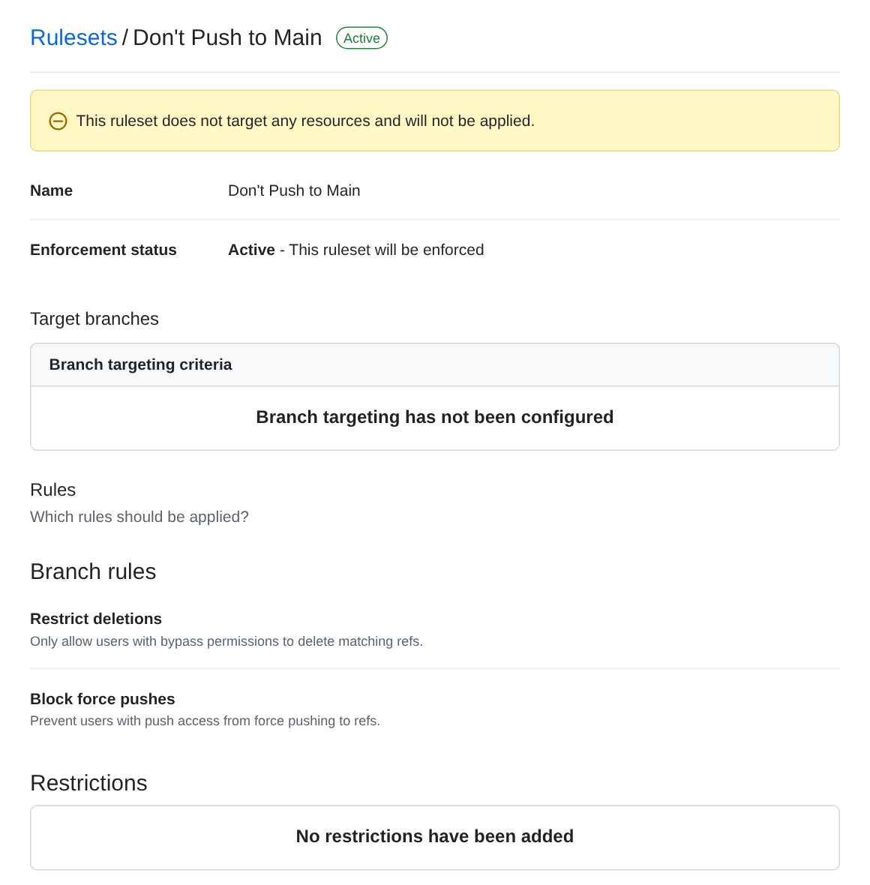
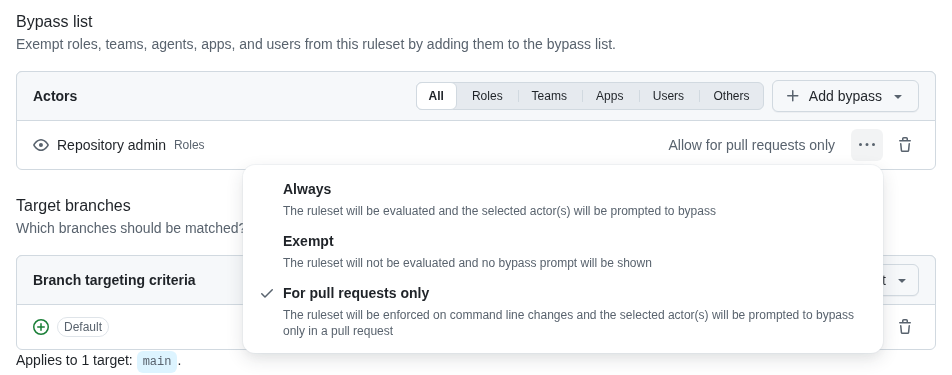

# Branch rules

This page answers: *how can a repository make sure every change to `main` goes through a pull
request, a review and a passing check, and why do the rules in the team's repositories stop so
little?*

[Pull requests and review](pull-requests-and-review.md) describes the habit. A **branch rule** is
how a repository enforces it: GitHub refuses a push or a merge that breaks the rule, whoever makes
it. Rules are easy to get subtly wrong, though, and the three sets of rules in the team's
repositories each look protective and leave `main` open in a different way. This page goes through
all three, because between them they show what each setting does.

## What a ruleset is

GitHub has two ways to set branch rules: the older "branch protection rules" and the newer
**rulesets**. The team's repositories use rulesets, so this page does too. A ruleset has five
parts:

- **A name**, which is only a label. A ruleset called "protect-main" protects whatever its other
  settings say, and nothing more.
- **An enforcement status**: active, or disabled.
- **Target branches**, the branches it applies to, given as names or patterns. The default branch
  (`main` in a Tiny Tapeout repository) is the usual target.
- **Rules**. The ones that matter here are *Restrict deletions* (nobody can delete the branch),
  *Block force pushes* (nobody can rewrite its history), *Require a pull request before merging*
  (nobody can push to it directly, and you can require some number of approvals), and *Require
  status checks to pass* (named jobs must have passed on the pull request's latest commit).
- **A bypass list**: people, teams or roles that may skip the rules. Each entry is either "Always
  allow", or "For pull requests only", in which case the actor "is now required to open a pull
  request" but may merge it without meeting the other requirements
  ([creating rulesets](https://docs.github.com/en/repositories/configuring-branches-and-merges-in-your-repository/managing-rulesets/creating-rulesets-for-a-repository)).

Rulesets, like the older protection rules, are available in public repositories on GitHub's free
plans, and in private repositories only on paid ones
([about rulesets](https://docs.github.com/en/repositories/configuring-branches-and-merges-in-your-repository/managing-rulesets/about-rulesets)).
The team's organization is on the free plan, so a private repository such as `dpll` can't have
branch rules at all. Anyone who can read a public repository can also read its rulesets, at
`github.com/<owner>/<repo>/rules`, which is how the pictures on this page were taken without
signing in.

## Three rulesets in the team's repositories

**`hart-1`, "Don't Push to Main"** (created Nov 15, 2026). Its name says what it's for, and
GitHub's own page for the ruleset says that it does nothing:

{width=640 fig-alt="The ruleset page for Don't Push to Main, marked Active, with a yellow banner: This ruleset does not target any resources and will not be applied. Under Target branches it says Branch targeting has not been configured. The branch rules are Restrict deletions and Block force pushes, and there are no restrictions."}

The ruleset is active, but its list of target branches is empty, so it applies to no branch.
Suppose it did target `main`, though. Its two rules stop anyone deleting `main` or force-pushing to
it, which are worth having, but neither stops an ordinary `git push` to `main`. To do what its name
says, it would also need *Require a pull request before merging* and the default branch as its
target.

**`crosswalk`, "protect-main"** (created Oct 31, 2026). This one is set up properly on paper. It
targets the default branch, restricts deletions, blocks force pushes, and requires a pull request
with one approval. Its bypass list, however, has one entry: a repository role, with "Always allow".
Since the ruleset was created, six commits have reached `main` without a pull request (`61156d4`,
`3985abc`, `34cf810`, `8973a92`, `685608c` and `2f71732`; the last is a merge made locally and
pushed, "Merge Sample/hold and CDAC, update interface details"), and all six pull requests merged in that
time were merged by their own authors with no approval. "Always allow" means exactly that:
everyone who holds the role is outside the rule for every push and every merge.

**`protocol-emulator`, "main"** (created Oct 24, 2026). This one targets `refs/heads/main`, blocks
force pushes and requires a pull request, with the required number of approvals set to zero, and
one person on the bypass list with "Always allow". Zero approvals is a reasonable choice: every
change still arrives as a pull request, with its diff and its workflow runs in one place, even when
nobody else is available to review it. The same repository has a second ruleset, "Branch Hierarchy
(L*) Ruleset", for branches named `L1/*`, `L2/*` and `L3/*`, which is disabled.

Rules like these are easy to end up with, because a ruleset with a reassuring name and a few rules
looks as if it's doing its job. Reading each of its five parts, as above, is how you check one.

## What your organization membership allows

When we checked on Nov 15, 2026, the `uoftasic` organization's base permission for members was
`write`: every member can push to every one of the organization's repositories, to any branch that
no rule protects. You'll become a member of the organization, and that means that in most of the
team's project repositories, the only thing between your laptop and their `main` is your own
judgment. Use your access the way you'd want others to use theirs: push to your own branch, open a
pull request, and leave `main` to the project's own process.

## Rules that do what they say

For a shared repository such as a team project, a ruleset that matches its name looks like this:

| Part | Setting |
|---|---|
| Enforcement | Active |
| Target | The default branch |
| Rules | Restrict deletions; Block force pushes; Require a pull request before merging, with at least one approval; Require status checks to pass, naming the jobs that must be green |
| Bypass list | Empty, or project leads with "For pull requests only" |

The status checks are named after jobs (`docs`, `test`, `gds`, `precheck`, `gl_test`, `viewer` in
the digital template; `docs`, `gds`, `precheck` and `viewer` in the analog one). Tiny Tapeout's
workflows run on every push, so a pull request from a branch in the same repository gets runs on
its latest commit, and those are the results the rule checks. A bypass "For pull requests only"
keeps a way for a project lead to merge an urgent fix without an approval, while still putting that
fix through a pull request where everyone can see it.

<!-- SCREENSHOT-TODO: The ruleset editor (Settings > Rules > Rulesets > New branch ruleset) of a repository you own, signed in, scrolled to "Bypass list" with a role added and its menu open, showing "Always allow" and "For pull requests only". -->
{width=640}

In [Lab 04](../labs/lab-04-a-change-through-review-overview.md) you'll work in a shared repository
with rules like these, and you'll see a pull request wait until it has both an approval and green
checks.

## Check yourself

1. A ruleset on `main` has two rules, Restrict deletions and Block force pushes, and it's active
   and targets the default branch. Can a member push a new commit straight to `main`?

Answer

Yes. Those rules stop the branch being deleted or its history being rewritten, but an ordinary push
adds commits without rewriting anything. To stop direct pushes, the ruleset needs *Require a pull
request before merging*.

2. `crosswalk`'s ruleset requires one approval, yet all six pull requests merged since it was
   created have none. How?

Answer

Its bypass list gives a repository role "Always allow", so anyone holding that role can merge
without an approval, and push to `main` without a pull request at all, which six commits did.

3. A friend's Tiny Tapeout repository is private, in a personal account on the free plan. Can they
   add a ruleset to protect `main`?

Answer

No. On GitHub's free plans, rulesets and branch protection are available only in public
repositories. They'd need to make the repository public (which this course does anyway, for free
runners and for Pages) or move to a paid plan.

4. What's the difference between "Always allow" and "For pull requests only" on a bypass list?

Answer

"Always allow" exempts the actor from every rule, so they can push directly to the branch.
"For pull requests only" still requires them to open a pull request, but lets them merge it without
meeting the other requirements, such as an approval, so their changes stay visible.

Next: the next page in this row of the [Course path](../index.md#course-path).
