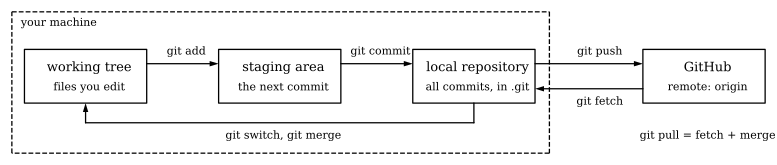
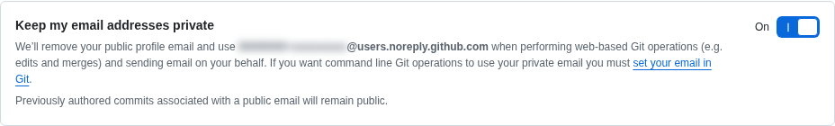

# Git in one page

This page answers: *what does git keep track of, and which few ideas do you need to work in a
Tiny Tapeout repository alongside other people?*

In IC101 you used git for exactly one thing, `git clone`. From Lab 01 of this course onwards you'll
make commits, push them to GitHub, open pull requests and read other people's history, so you need
a working picture of what git is doing. This page gives you that picture and nothing more. The
commands themselves are in the labs, where you'll type them; here we explain what they do and why
the team's repositories look the way they do.

## Four places a change lives

A change you make to a file passes through four places before anyone else can see it:

{width=760 fig-alt="Four boxes in a row. The first three, working tree (files you edit), staging area (the next commit) and local repository (all commits, in .git), sit inside a dashed box labelled your machine. The fourth, GitHub (remote: origin), is outside it. Arrows labelled git add, git commit and git push run left to right between neighbouring boxes. An arrow labelled git fetch runs from GitHub back to the local repository, and a line labelled git switch, git merge runs from the local repository back to the working tree. A note under GitHub says git pull = fetch + merge."}

The **working tree** is the folder of files you open in your editor. Git watches it but doesn't
record anything until you ask. `git add` copies a file's current contents into the **staging
area**, which is git's draft of the next commit, and `git commit` turns that draft into a
permanent record in the **local repository**, the hidden `.git` folder at the top of your clone.
None of this has left your laptop yet. `git push` sends your new commits to the **remote**, the
copy on GitHub, which git calls `origin` because it's where you cloned from.

A **commit** is a snapshot of every tracked file, plus a message, an author, a date and a pointer
to the commit before it (its parent). Git names each commit by a hash of all that, which is why the
team's history is full of names like `b976406`: that's the first seven characters of a 40-character
hash, and seven are almost always enough to pick out one commit in a repository.

A **branch** is just a name that points at a commit, and it moves forward each time you commit on
it. `main` is the branch everyone shares; you'll do your work on a branch of your own and bring it
into `main` with a pull request, which [Pull requests and review](pull-requests-and-review.md)
explains. Going the other way, `git fetch` brings down commits other people pushed, and `git merge`
or `git switch` brings them into your working tree. `git pull` does the fetch and the merge in one
step.

The push is the step that matters most in a Tiny Tapeout repository, because GitHub runs the
template's workflows on every push, and a commit that hasn't been pushed hasn't been checked.

## Commit identity

Every commit records an author name and an email address, taken from your git settings
(`user.name` and `user.email`) at the moment you commit. Both are part of the commit itself, so
they're public in a public repository, and anyone who clones it can list every address in the
history with one command.

In four of the team's repositories (`sentry`, `simproc`, `crosswalk` and `asic-zoo-template`) the
history shows the same person committing under two addresses: a personal one and a GitHub no-reply
one. It's an easy thing to do, since every machine you commit from has its own git settings, and
nobody did anything wrong. The personal addresses are in the history for good, though, because
changing an old commit changes its hash and the hash of every commit after it.

GitHub gives every account a no-reply address of the form `ID+USERNAME@users.noreply.github.com`
([GitHub's email reference](https://docs.github.com/en/account-and-profile/reference/email-addresses-reference)),
and setting `user.email` to it before your first commit keeps your personal address out of every
repository you work in. That's the first thing you'll do in
[Lab 01](../labs/lab-01-your-repo-from-the-template-overview.md).

{width=640}

## Commit messages

A good commit does one thing, and its message says what that thing is and, when it isn't obvious,
why. The reason this matters is that the history is the only record most projects keep. Six weeks
from now nobody will remember why a line changed, and the message will be the only place to find
out.

Here are three real commits from `protocol-emulator`, all made while getting its workflows to pass:

| Commit | Message | What it changed |
|---|---|---|
| `b976406` | `docs: update info.yaml` | `info.yaml`, and the module name in `src/project.v` |
| `a5f1475` | `chore: temporarily remove assertion from test.py` | Commented out the template's only assertion |
| `7c56c54` | `chore: updated module name in testbench` | `test/tb.v`, to match the new module name |

These are ordinary messages, and most of us have written ones like them. They're worth a second
look because of what happened next. The first commit renamed the design's top module, but its
message mentions only `info.yaml`, so when the test workflow started failing at that commit, the
message gave no hint why. The second one says what it did and not why, and "temporarily" is still
true on `main` two weeks later: the assertion is commented out, so the test that passes there
checks nothing. [History as evidence](history-as-evidence.md) follows this story further.

Compare `b1896da` in `ttsky-verilog-tinyCGRA`, "removed config_done assert (unreliable in GLS)".
It also removes an assertion, but it says which one and gives a reason a reviewer can argue with.
That's the standard to aim for. If a message needs more than a line, write a short summary line,
a blank line, and then the explanation underneath; git and GitHub both show the first line on its
own in lists.

## Files that stay out of git

A repository should hold the files you wrote and nothing that a tool can regenerate from them.
Generated files change on every run, they're often large, and they make every diff noisy, so a
reviewer can't see your real change among them. The file `.gitignore` lists the paths git should
pretend aren't there. The digital template ships this one:

```
.DS_Store
.idea
*.vcd
*.fst
*.fst.hier
runs
tt_submission
src/user_config.json
src/config_merged.json
test/sim_build
test/__pycache__/
test/results.xml
test/gate_level_netlist.v
```

Every line is something a tool writes: waveforms (`*.vcd`, `*.fst`), the LibreLane run directory
(`runs`), the simulator's build folder and results, and the gate-level netlist the GDS action copies
into `test/`. When a project adds a new place for tools to write, it needs a new line here.
`crosswalk` did exactly that in pull request #5, "Ignore simulation output", which added
`test/digital/sim_build/`, `test/digital/results.xml`, `test/digital/tb.fst`,
`test/digital/__pycache__/` and `*.raw` after the repository was split into analog and digital
parts.

Once a file has been committed, ignoring it later doesn't remove it from the history. `sentry`
keeps two trace files in its top folder, `ata_read.csv` (1.6 MB) and `ata_write.csv` (393 KB).
They were added in a commit called "first test case", reverted the same day, and added again the
next day. Whether those traces belong in the repository is the project's call, and there can be
good reasons to keep test data with the code. Either way the decision is permanent, because even
after a revert every clone of the repository downloads them.

Two exceptions matter in this course. In IC102-A you commit GDS and LEF files on purpose, because
the analog workflow reads your layout from the repository instead of building it. And nothing
secret ever goes in a repository, ignored or not, because a single mistaken `git add` publishes it.

## Branches, merges and conflicts

Work on a branch, and git can bring two lines of work back together with a merge. Most merges need
no help, because the two branches changed different files or different lines. When both branches
changed the same lines, git stops and asks you to decide, and that's called a **merge conflict**.

In a Tiny Tapeout repository the most likely place for one is the pinout in `info.yaml`, because
everyone who adds a block also claims pins there. Here is a real run, on a copy of the template's
`info.yaml`, where one branch named `uart` gives `uo[0]` to a UART transmitter and another named
`pwm` gives the same pin to a PWM output. Both are merged into `main`:

```
$ git merge uart
Updating bc18097..e3031f2
Fast-forward
 info.yaml | 2 +-
 1 file changed, 1 insertion(+), 1 deletion(-)
$ git merge pwm
Auto-merging info.yaml
CONFLICT (content): Merge conflict in info.yaml
Automatic merge failed; fix conflicts and then commit the result.
```

The first merge is a **fast-forward**: `main` had no commits of its own since `uart` branched off,
so git simply moved the `main` label forward. The second merge can't do that, and git writes both
versions into the file, between markers:

```
  # Outputs
<<<<<<< HEAD
  uo[0]: "UART TX"
=======
  uo[0]: "PWM out"
>>>>>>> pwm
  uo[1]: ""
```

Between `<<<<<<< HEAD` and `=======` is what's on the branch you're merging into, and between
`=======` and `>>>>>>> pwm` is what the other branch wants. Git can't know which is right, and here
neither is: two signals can't share a pin, so one of them has to move to `uo[1]`, and that's a
design decision the two authors have to make together. Resolving a conflict means editing the file
to what it should say, deleting the three marker lines, and committing the result. You'll resolve a
pinout conflict like this one in
[Lab 04](../labs/lab-04-a-change-through-review-overview.md).

## Undoing a commit

There are two ways to undo a commit, and which one is safe depends on whether anyone else has it.

**`git revert`** makes a new commit that does the opposite of an old one. The history keeps both,
so anyone who already has the old commit just gets one more on top. `sentry` has one on `main`,
`d12a672`, whose message git wrote automatically:

```
Revert "first test case"

This reverts commit f0804819d4a77338811fe40a080d9eae9d4e6473.
```

**`git reset`** moves your branch label back to an earlier commit, as if the later ones had never
happened. That's fine for commits that exist only on your laptop. Once they've been pushed, though,
other people may have built on them, and putting the reset on GitHub needs a **force push**, which
replaces the branch there with yours. Anyone whose work was based on the commits you removed is now
out of step, and the next time they pull and push, the commits you removed can come straight back.

So the rule is to revert on any branch someone else might have, and to reset only what you haven't
pushed. A repository can enforce the first half of this with a branch rule that blocks force
pushes. `crosswalk` and `protocol-emulator` have one on `main`, and `hart-1` has one that, as
[Branch rules](branch-rules.md) shows, doesn't apply to any branch at all.

## Check yourself

1. You made three commits with your personal email address and pushed them to a public
   repository. You then set `user.email` to your no-reply address. Which of your commits show the
   personal address now, and why can't you simply edit them?

<details>
<summary>Answer</summary>

All three still do. The setting applies only to commits you make after changing it. The address is
part of each old commit, and changing a commit changes its hash and the hash of every commit after
it, which on a shared branch means a force push and trouble for everyone who has the old commits.
That's why you set the address before your first commit.

</details>

2. A teammate's commit on `main` broke the test workflow, and three other people have pulled since.
   Should you fix it with `git revert` or with `git reset` and a force push?

<details>
<summary>Answer</summary>

`git revert`. It adds a new commit that undoes the broken one, so everyone else's copy stays
consistent and the history shows both what went wrong and how it was undone. A reset and force push
would remove a commit that three people already have.

</details>

3. Which of these belong in a digital Tiny Tapeout repository: `src/project.v`, `test/results.xml`,
   `runs/`, `info.yaml`, `test/tb.fst`?

<details>
<summary>Answer</summary>

`src/project.v` and `info.yaml`, because you wrote them and no tool can recreate them. The other
three are written by tools on every run (the test results, LibreLane's run folder and a waveform),
and the template's `.gitignore` already lists all three.

</details>

4. In the conflict above, what does the text between `=======` and `>>>>>>> pwm` hold?

<details>
<summary>Answer</summary>

The `pwm` branch's version of the line, `uo[0]: "PWM out"`. The part above `=======` is the version
already on the branch you're merging into (`HEAD`, which here is `main` with `uart` merged in).

</details>

Next: [Templates, forks and clones](templates-forks-and-clones.md).
