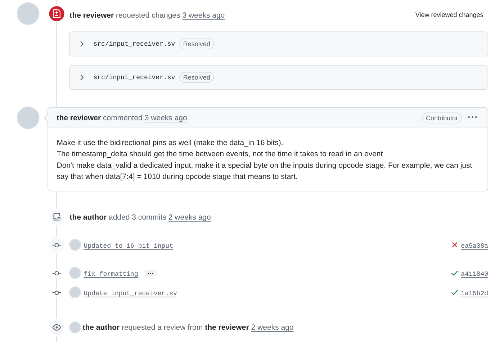
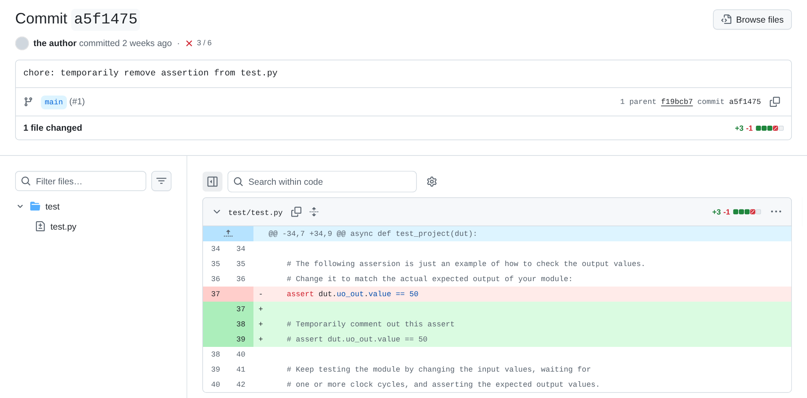

# Pull requests and review

This page answers: *how does a change get from your branch into the `main` that everyone shares,
and what is a reviewer for, when the workflows already check so much?*

A **pull request** asks for one branch to be merged into another, usually into `main`. GitHub shows
the change as a diff, shows the workflow runs on the branch's latest commit, and gives everyone a
place to discuss it before anything on `main` changes. Review is the discussion part: another
person reads the change and either approves it or asks for changes. In
[Lab 04](../labs/lab-04-a-change-through-review-overview.md) you'll take a change of your own
through review in a shared repository and review a classmate's.

## Issues, branches and pull requests

Work on a project usually starts as an **issue**, a numbered note in the repository that says what
needs doing. `sentry` shows the habit that keeps issues useful: its branches are named after the
issue they work on (`12-implement-rtl-for-window-controller-module`,
`57-rewrite-input-decoder-unit-tests-in-systemverilog`), so anyone looking at the branch list can
find the discussion behind each one. Its pull request #33, "Event Decoder FSM", was linked to issue
#3, "Implement Input Decoder RTL", and merging the pull request closed the issue. The same link can
be made from the description: `hart-1`'s pull request #5 begins with `Closes #2`, which closed
issue #2 when it was merged.

The link matters in both directions. An issue that never hears about the work done for it stays
open, and the work is invisible to anyone who reads the issue. `dpll` has three issues, "PFD -
Design", "DCO - Design" and "Freq. Divider - Design", open since Oct 24, 2025. Four commits for the
frequency divider, dated Nov 1 and 2, 2025, sit on a branch called `frequency-divider`, the last
one titled "integrated with main". No pull request was opened, so none of that work reached `main`,
which still has only its first commit, and the issue still reads as if nothing had happened.

## What review is for

The team's own record shows how rarely review happens. These are the merged pull requests in five
of the team's repositories on Nov 15, 2026:

| Repository | Merged pull requests | Merged by their own author | With at least one review |
|---|---|---|---|
| `crosswalk` | 6 | 6 | 0 |
| `protocol-emulator` | 1 | 1 | 0 |
| `ttsky-verilog-tinyCGRA` | 2 | 1 | 1 |
| `hart-1` | 1 | 0 | 0 |
| `sentry` | 10 | 2 | 2 |

Seventeen of the twenty were merged without anyone else reading them. That's common in small teams
moving quickly, and the workflows did catch some problems along the way. The workflows can't judge
whether the design is right, though, and that judgment is what a reviewer adds. `sentry`'s pull request #33 had thirteen
reviews, and an early round shows what they were for:

{width=760 fig-alt="A pull request timeline. The reviewer requested changes, with two resolved comment threads on src/input_receiver.sv, then commented: make it use the bidirectional pins as well (make the data_in 16 bits); the timestamp_delta should get the time between events, not the time it takes to read in an event; don't make data_valid a dedicated input, make it a special byte on the inputs during opcode stage. The author then added three commits, Updated to 16 bit input, fix formatting and Update input_receiver.sv, and requested a review from the reviewer."}

The reviewer asked for three changes: use the bidirectional pins as well, which makes `data_in` 16
bits wide; have `timestamp_delta` measure the time between events, not the time it takes to read
one; and signal `data_valid` with a special byte on the inputs during the opcode stage, instead of
a dedicated input. None of those three requests could come from a workflow. Each is a decision about what the design
should do, made by someone who knew what it was for, and each is easier to settle before a merge
than after other blocks depend on it.

## Writing a pull request someone can review

A reviewer can only review what they can understand, so the author's job is to make that easy. Two
things decide it: the description and the size.

**The description** should say what the change does, why, how you tested it, and what you know is
still wrong. `protocol-emulator`'s pull request #2, open since Nov 9, 2026, is a good model. It has
a summary, the new pinout, a table of the tests it adds with one line each on what they check, and
a section headed "Expected CI failure" that explains, before anyone asks, why one of its own tests
fails:

> `test_uio_pin_directions` **fails on purpose**. `uio[0]` is read as UART RX but also driven as
> UART TX (`uio_oe[0] = 1`). On silicon the RX input would read back our own TX and fight an
> external driver. One fix: move TX to `uio_out[2]` with `uio_oe = 8'b0000_0100` and update
> `info.yaml`. This is left for review because it changes the pinout.

When we looked on Nov 15, the pull request was still waiting for that decision, with no reviews.

**The size** should be small enough to read in one sitting. `hart-1`'s pull request #5 added 7,408
lines in 47 files, and it was merged on Nov 15, three weeks after it was opened, without a review.
Most of those lines are TinyQV, an open-source processor core copied into `src/tinyQV/`, and the
description says so: "Everything outside src/tinyQV/ is our code", with a pointer to an
`UPSTREAM.md` file that records exactly where the copy came from. That makes the pull request
reviewable in two parts. The copied part can be checked mechanically, by comparing it with the
upstream commit `UPSTREAM.md` names, and only the rest needs reading line by line.
[How open-source projects work](how-open-source-projects-work.md#copying-someone-elses-code) says
more about copying code this way. It would have been easier still as two pull requests, one for the
copy and one for the team's own files.

If you want feedback before a change is finished, open the pull request as a **draft**. A draft
shows the diff and runs the workflows like any other pull request, but can't be merged until you
mark it ready for review, so it's safe to open early.

## What a reviewer checks that CI can't

The workflows check that `info.yaml` parses, that the layout builds and passes precheck, and that
the tests pass. They can't check that the values make sense, that the tests test anything, or that
the design does what it should. Those are the reviewer's job, and the team's repositories have an
example of each.

**Values that pass validation and are still wrong.** The validator requires `clock_hz` to be an
integer, so `clock_hz: 50` passes. `protocol-emulator`'s pull request #2 points out that it "should
probably be `50000000`", which is a factor of a million that no workflow would notice.

**Pins that the tests don't look at.** A design can read a pin as an input and drive the same pin
as an output, with `uio_oe` set, and every workflow will pass, because nothing in them knows what
the pins are for. `protocol-emulator`'s `uio[0]` problem was found only because someone wrote a test
specifically for pin directions.

**Tests that no longer test anything.** A deleted or commented-out assertion makes a red test green
without changing the design at all. Here is the commit in `protocol-emulator` that did it. The red
cross and `3 / 6` at the top are GitHub's summary of the checks on that commit: three of the six
jobs passed, and `test`, `gl_test` and `viewer` failed.

{width=760 fig-alt="The GitHub page for commit a5f1475, chore: temporarily remove assertion from test.py, on main, with a red cross and 3 / 6 next to it. The diff of test/test.py removes the line assert dut.uo_out.value == 50 and adds a blank line, the comment Temporarily comment out this assert, and the same assertion commented out."}

`ttsky-verilog-tinyCGRA` has a run of the same kind of commit from May 2026, titled "comment
assert input in load_input()", "comment all user_project asserts" and "commented asserts, no
functional testing". Sometimes removing an assertion is the right call, and the pull request that
was finally merged there includes one such commit, "removed config_done assert (unreliable in
GLS)", which says which assertion and why. A reviewer's job is to notice every removed check and ask
for that reason when it's missing.

**Layouts, which a diff can't show.** In IC102-A your change is a GDS file, which is binary, so the
diff tells a reviewer nothing beyond "this file changed". Review a layout from the PNG render in the
`gds_render` artifact and from the precheck report instead.

When you review, a short list helps:

- Do the tests still assert something, and is every removed or weakened check explained?
- Do the `info.yaml` values make sense: `clock_hz`, `tiles`, the pinout, and does the pinout match
  how the design drives `uio_oe`?
- Does the description match the diff? Does it claim anything the diff doesn't do, or leave out
  something the diff does?
- Are the runs on the branch's latest commit green, or is every red one explained?
- Has anything generated, large or secret been committed?

When you ask for a change, say what and why, as the `sentry` reviewer did, and when the author has
made it, look again and approve.

## Pull requests written with AI tools

You may use AI tools, such as Claude, ChatGPT or Copilot, to help you write code and pull requests
in this course, and the team's repositories already have pull requests written that way.
`protocol-emulator`'s #2 ends with "Generated with Claude Code", as does `hart-1`'s #4 (closed in
favour of #5), and `ttsky-verilog-tinyCGRA`'s #3 was opened by the Copilot coding agent (it happens
to be the only one of that repository's pull requests with a review).

Two rules make that work. First, the person who opens a pull request answers for every line in it,
however it was written. Say in the description which parts a tool wrote and what you checked
yourself, so a reviewer knows where to look hardest. Second, as a reviewer, treat what a
description says as claims to check. Pull request #2 says, for example, that "Icarus rejected the
use-before-declaration, so the design didn't build", and that 6 of its 7 tests pass under
"Icarus, cocotb 2.0.1". Each of those can be checked by running the tests at the pull request's
latest commit, and a reviewer should, because a tool can state something fluently that turns out
not to be true. Tools also make large pull requests cheap to write, without making them any cheaper
to review, so the advice on size above applies with extra force, and so does the habit of looking
for deleted assertions.

## Check yourself

1. A pull request changes `clock_hz: 50` to `clock_hz: 50000000`, and every workflow was already
   green before it. Is it worth reviewing, and why didn't any workflow complain about the old value?

Answer

Yes. The validator only checks that `clock_hz` is an integer, so 50 passes even though it means
50 Hz. Checking that the value matches the real clock (here 50 MHz, a factor of a million) is
exactly the kind of thing only a person can do.

2. A pull request adds 7,000 lines, nearly all of them an open-source core copied into one folder.
   How can you review it without reading every line?

Answer

Check the copied folder against the upstream commit its provenance file names (in `hart-1`,
`UPSTREAM.md`), which a tool can compare for you, and read the files outside that folder in full.
Better still, ask for it as two pull requests, one for the copy and one for the team's own files.

3. Which of these would a workflow catch, and which needs a reviewer: an empty project title, a
   commented-out assertion, a `uio` pin that's both read and driven, a DRC error in a layout?

Answer

The empty title (the docs and gds workflows fail) and the DRC error (precheck fails) are caught by
workflows. The commented-out assertion makes the test pass, and the pin problem passes everything
unless someone has written a test for it, so both need a reviewer.

4. You used an AI tool to write the cocotb test in your pull request. What should your description
   say about it?

Answer

That the tool wrote the test, what you checked yourself (for example, that the test fails on the
bug it's meant to catch and passes on the fix), and anything you weren't able to check. You're
responsible for the test either way, and saying this tells your reviewer where to look hardest.

Next: [Branch rules](branch-rules.md).
