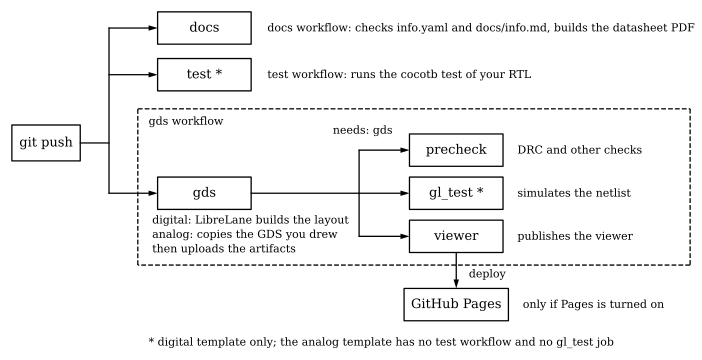
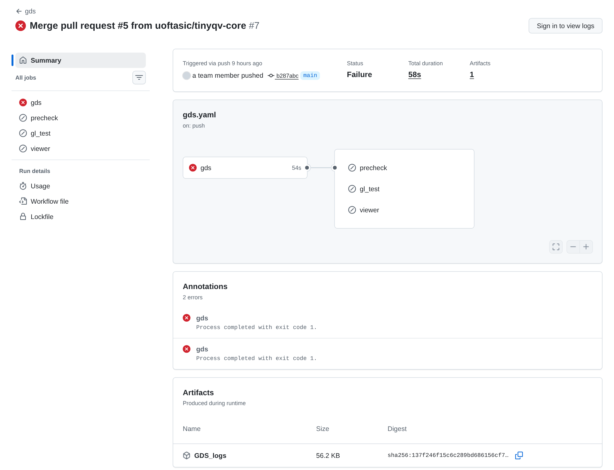
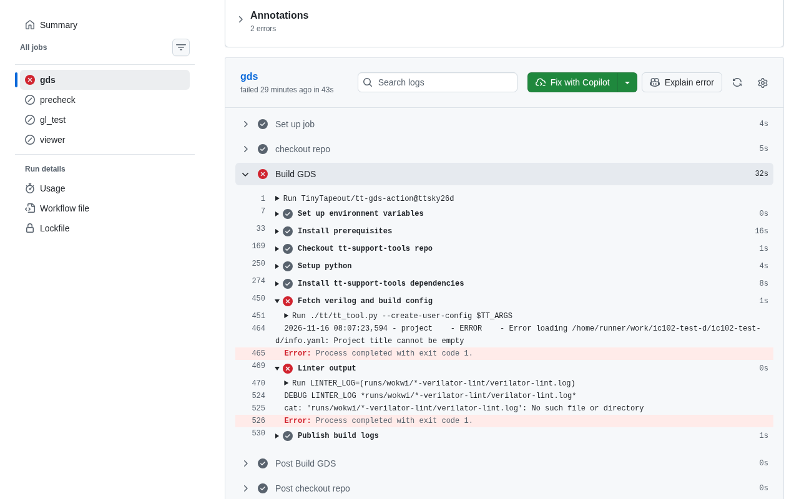
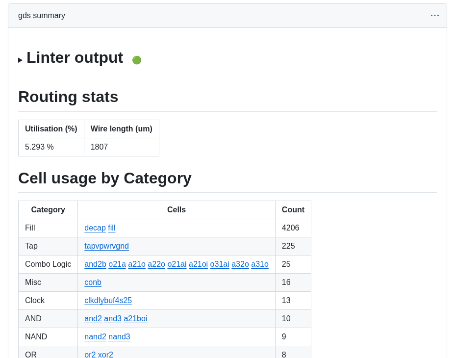
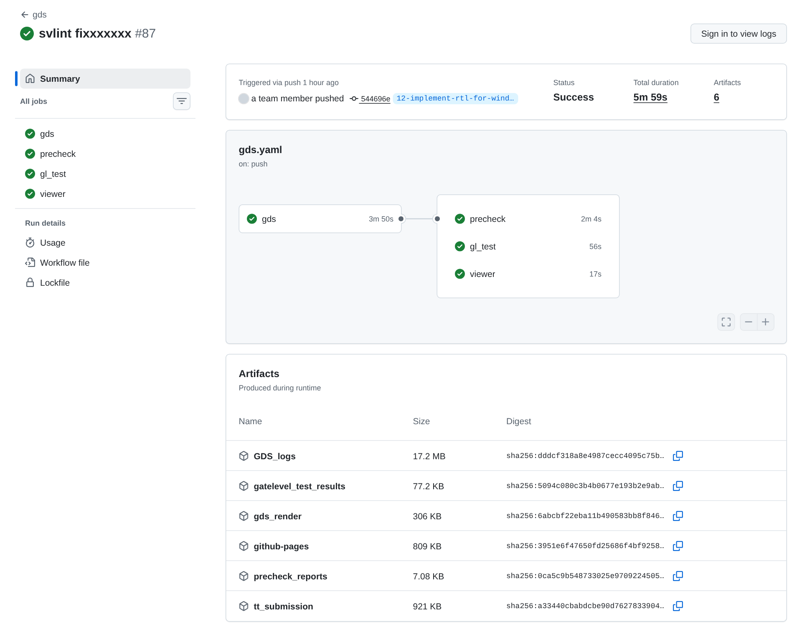
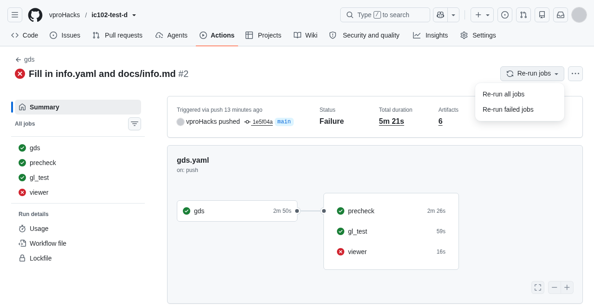
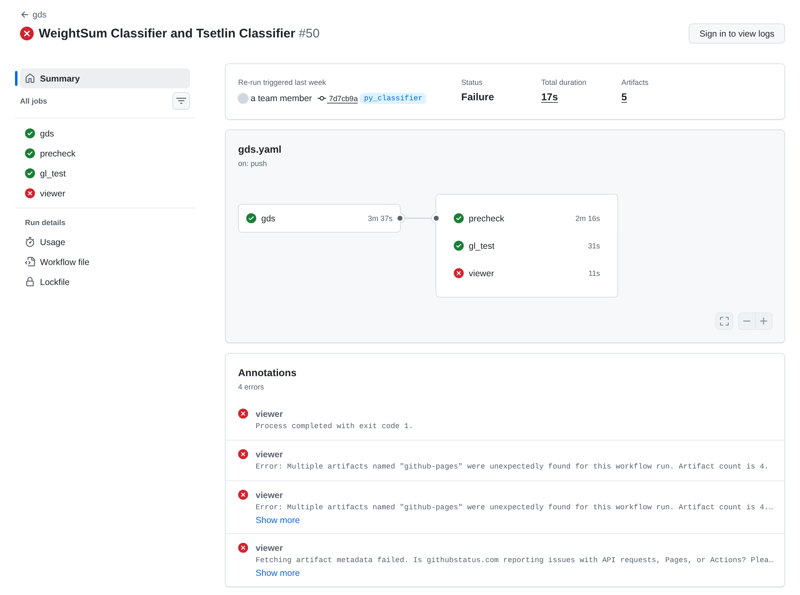
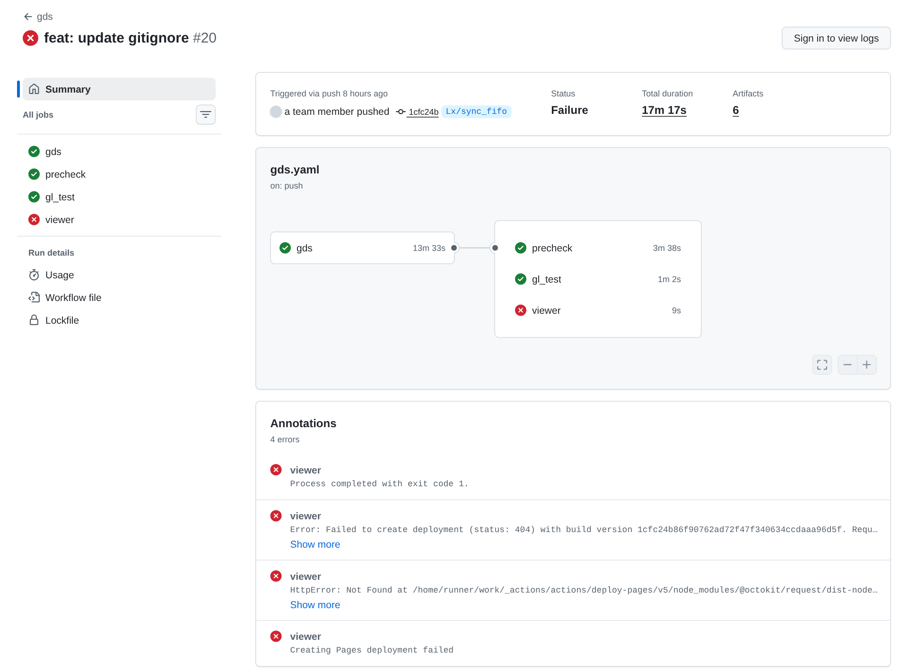
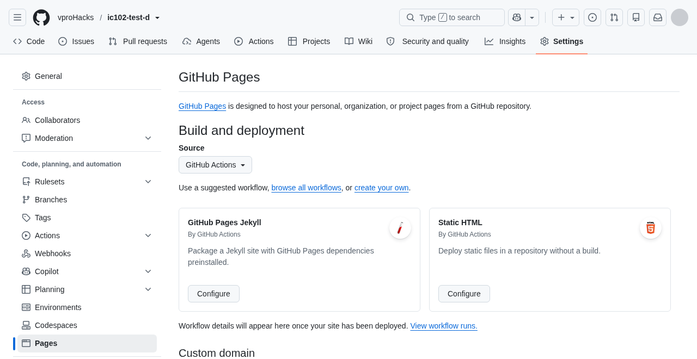

# Reading a workflow file

This page answers: *what does a workflow file tell GitHub to do, and when a run goes red, how do
you find the one line that says why?*

You won't need to write a workflow from scratch in this course, because Tiny Tapeout has written
them for you. You will read them, though, and read the runs they produce, because a red cross on its
own tells you only that something failed. The workflow file tells you what was supposed to happen, and the run's log tells
you where it stopped. With both, most failures take a minute to explain. You'll practise this on
five broken commits in [Lab 02](../labs/lab-02-read-the-red-x-overview.md).

## What a push starts

Each YAML file in `.github/workflows/` is one **workflow**. When you push, GitHub starts every
workflow whose trigger includes a push, and each one becomes a separate **run** with its own entry
on the Actions tab and its own tick or cross next to your commit. A run is made of **jobs**, and
each job is a list of **steps**.

{width=760 fig-alt="A box labelled git push branches to three jobs. The first, docs, has the note: docs workflow: checks info.yaml and docs/info.md, builds the datasheet PDF. The second, test with an asterisk, has the note: test workflow: runs the cocotb test of your RTL. The third, gds, sits inside a dashed box labelled gds workflow, with the notes: digital: LibreLane builds the layout; analog: copies the GDS you drew; then uploads the artifacts. From gds, a line labelled needs: gds branches to three more jobs: precheck (DRC and other checks), gl_test with an asterisk (simulates the netlist) and viewer (publishes the viewer). An arrow labelled deploy leads from viewer, out of the dashed box, to a box labelled GitHub Pages, with the note: only if Pages is turned on. A footnote says: digital template only; the analog template has no test workflow and no gl_test job."}

The digital template has four workflow files (`docs.yaml`, `test.yaml`, `gds.yaml` and
`fpga.yaml`), but `fpga` is switched off, so a push starts three runs. The analog template has two,
`docs.yaml` and `gds.yaml`. The page after this one in the course path goes through your template's
workflows job by job; this page is about how to read any of them.

## The parts of a workflow file

Here is the digital template's `gds.yaml` in full, as it was at the template's commit `a42e666`
(Oct 14, 2026):

```yaml
name: gds

on:
  push:
  workflow_dispatch:

jobs:
  gds:
    runs-on: ubuntu-24.04
    steps:
      - name: checkout repo
        uses: actions/checkout@v6
        with:
          submodules: recursive

      - name: Build GDS
        uses: TinyTapeout/tt-gds-action@ttsky26d
        with:
          pdk: sky130A

  precheck:
    needs: gds
    runs-on: ubuntu-24.04
    steps:
      - name: Run Tiny Tapeout Precheck
        uses: TinyTapeout/tt-gds-action/precheck@ttsky26d

  gl_test:
    needs: gds
    runs-on: ubuntu-24.04
    steps:
      - name: checkout repo
        uses: actions/checkout@v6
        with:
          submodules: recursive

      - name: GL test
        uses: TinyTapeout/tt-gds-action/gl_test@ttsky26d

  viewer:
    needs: gds
    runs-on: ubuntu-24.04
    permissions:
      pages: write      # to deploy to Pages
      id-token: write   # to verify the deployment originates from an appropriate source
    steps:
      - uses: TinyTapeout/tt-gds-action/viewer@ttsky26d
```

Reading it from the top:

- **`name`** is what the Actions tab and the badges call the workflow.
- **`on`** says what starts it. Here that's `push`, on any branch, and `workflow_dispatch`, which
  puts a **Run workflow** button on the Actions tab so you can start a run by hand. None of the
  template's workflows list `pull_request`, so opening a pull request doesn't start anything by
  itself; the runs you see on a pull request come from the pushes to its branch.
- **`jobs`** holds four jobs, named `gds`, `precheck`, `gl_test` and `viewer`. Each runs on its own
  fresh machine, chosen by **`runs-on: ubuntu-24.04`**, which is why
  [What a cloud runner is](what-a-cloud-runner-is.md) matters here.
- **`needs: gds`** makes a job wait until `gds` has finished, and run only if it succeeded. Jobs
  without `needs` start at once and in parallel, so the three jobs that need `gds` all start
  together when it's done.
- **`steps`** run in order, and a step either runs a shell command (`run:`, as in `test.yaml`) or
  calls an **action** (`uses:`), which is a packaged set of steps kept in another repository. The
  text after the `@` is the version of the action to use: a tag (`ttsky26d`), a version number
  (`v6`), or a commit hash.
- **`with`** passes inputs to an action: `submodules: recursive` tells the checkout action to fetch
  submodules too, and `pdk: sky130A` tells Tiny Tapeout's action which process to build for.
- **`permissions`** sets what the job's automatic access token may do. `viewer` asks to write to
  Pages and to get an identity token, because GitHub requires "a minimum of `pages: write` and
  `id-token: write` permissions" for a job that deploys a Pages site
  ([custom workflows](https://docs.github.com/en/pages/getting-started-with-github-pages/using-custom-workflows-with-github-pages)).

The analog template's `gds.yaml` has the same shape with two differences. Its `gds` job reads
`top_module` from `info.yaml` and passes `gds/<top_module>.gds` and `lef/<top_module>.lef` to a
different action, `tt-gds-action/custom_gds`, which copies and converts your layout instead of
building one. It also has no `gl_test` job.

One step in the digital `test.yaml` is worth reading closely, because it shows how a step decides
whether it passed:

```yaml
      - name: Run tests
        run: |
          cd test
          make clean
          make
          # make will return success even if the tests fail, so check results.xml for failed tests
          python -m cocotb_tools.check_results results.xml
```

GitHub runs these lines with `bash -e` (the log prints `shell: /usr/bin/bash -e {0}` above the
step), so the step stops and fails as soon as any command exits with a non-zero status, and passes
if none does. That exit status is all GitHub looks at. The comment above the last line was true of
cocotb 1.x, whose `make` exited with status 0 even when a test failed, which is why the template
adds a command that reads the results file and exits non-zero if any test failed. The template now
pins cocotb 2.1.0, and with cocotb 2.x `make` runs that same check itself at the end of the
simulation, so a failing test stops the step at `make`, and the last line is a second check that
only runs when `make` has passed. Either way, what turns a failing test into a red step is a
command that exits non-zero. You'll need the same idea in
[Lab 05](../labs/lab-05-find-the-commit-that-broke-it-overview.md), where a script has to tell git
whether a commit passed.

## Composite actions

The `gds` job above has two steps, and the second is one line:
`uses: TinyTapeout/tt-gds-action@ttsky26d`. That line runs a **composite action**, a file called
`action.yml` in the `TinyTapeout/tt-gds-action` repository whose steps run inside your job as if
you'd written them yourself. At the `ttsky26d` tag it has 18 steps, beginning with "Set up
environment variables" and "Install prerequisites", going through "Fetch verilog and build config",
"Install LibreLane" and "Make GDS with LibreLane", and ending with "Publish tt_submission artifact",
"Render PNG from GDS" and "Upload gds_render (png) artifact". In the log, all 18 appear as sections
nested inside "Build GDS", so when "Build GDS" fails, you open it and look for the section that
failed inside it.

A tag is only a name for a commit, and its owner can move it. Tiny Tapeout's own README for the
action describes doing exactly that with `git tag -fa` and `git push --force` when they update a
release. The log records which commit the tag pointed to when your job ran, in a line near the top
of each job. This is from a `sentry` run on Nov 6, 2026, on the tag the current SKY130 templates
use:

```
Download action repository 'TinyTapeout/tt-gds-action@ttsky26d' (SHA:395eedb3eeec3c2f4961c3b04ff2cf87f5525636)
```

If a run that passed last month fails today with no change on your side, compare that hash between
the two logs. (The action also fetches Tiny Tapeout's support tools from their `main` branch by
default, so those can change between runs even when the tag stays where it was.)

## Reading a failed run

The path to the cause is always the same: the run, then the job that failed, then the step that
failed inside it, then the first error line in that step. GitHub helps with the third part: "Any
failed steps are automatically expanded" when you open a job's log
([workflow run logs](https://docs.github.com/en/actions/how-tos/monitor-workflows/use-workflow-run-logs)).

Start with the run's summary page. Anyone can see it for a public repository, even without
signing in. Here's the `gds` run that `hart-1` made when pull request #5 was merged on Nov 15,
2026 ([run 43752267356](https://github.com/uoftasic/hart-1/actions/runs/43752267356)):

{width=760 fig-alt="A workflow run summary for gds.yaml. The gds job has a red cross and took 54 s. The precheck, gl_test and viewer jobs have grey skipped icons. The Annotations box lists 2 errors, both on gds and both reading Process completed with exit code 1. One artifact, GDS_logs, 56.2 KB, was uploaded."}

The graph tells you two things at once. The `gds` job failed after 54 seconds, which is far too
short for a layout build, and the other three jobs never ran: their grey icons mean "skipped",
because each `needs: gds`. The **annotations** box lists the errors GitHub picked out of the log,
but here both just say `Process completed with exit code 1.` They tell you that two steps failed,
and not why. For that you need the log itself, which GitHub shows only when you're signed in.

<!-- SCREENSHOT-TODO: hart-1 gds run 43752267356, gds job log, signed in, with the failed "Build GDS" step expanded and scrolled to the line "Error loading /home/runner/work/hart-1/hart-1/info.yaml: Project title cannot be empty, ...". -->
{width=760}

Inside "Build GDS", the step "Fetch verilog and build config" stops with this, which is the cause:

```
2026-11-15 19:25:32,583 - project    - ERROR    - Error loading /home/runner/work/hart-1/hart-1/info.yaml: Project title cannot be empty, Project author cannot be empty, Project description cannot be empty
##[error]Process completed with exit code 1.
```

Most of the steps after it are skipped, but two still run. "Publish build logs" uploads whatever
logs exist as the `GDS_logs` artifact, and before it, "Linter output" prints a second error:

```
DEBUG LINTER_LOG *runs/wokwi/*-verilator-lint/verilator-lint.log*
cat: 'runs/wokwi/*-verilator-lint/verilator-lint.log': No such file or directory
##[error]Process completed with exit code 1.
```

That step is marked `if: always()` in the action, so it runs even after an earlier step has
failed, and it fails because the linter it reports on never ran. It's a consequence, not a second
problem, and fixing `info.yaml` makes both errors go away. That's the general rule for logs: read
from the top, take the first real error as the cause, and be suspicious of anything printed by a
step that runs `always()` or `if: failure()`, because those steps exist to clean up and report
after something else has already gone wrong.

The same pattern shows up in the `test` workflow. When `protocol-emulator` renamed its top module
in `src/project.v` but not in `test/tb.v`
([run 40123836544](https://github.com/uoftasic/protocol-emulator/actions/runs/40123836544)), the
"Run tests" step stopped with the cause:

```
/home/runner/work/protocol-emulator/protocol-emulator/test/tb.v:27: error: Unknown module type: tt_um_example
2 error(s) during elaboration.
*** These modules were missing:
        tt_um_example referenced 1 times.
***
```

and the two steps that run afterwards regardless each added a message of their own:

```
##[error]ENOENT: no such file or directory, open 'test/results.xml'
```

```
##[warning]No files were found with the provided path: test/tb.fst
test/results.xml
test/output/*. No artifacts will be uploaded.
```

Neither of those is a separate problem. The simulation never started, so there was no results
file to summarise and no waveform to upload. The fix was one line in `test/tb.v`.

## Job summaries and artifacts

A step can write Markdown to the run's summary page through a file whose path is in the variable
`$GITHUB_STEP_SUMMARY`, up to 1 MiB per step
([workflow commands](https://docs.github.com/en/actions/reference/workflows-and-actions/workflow-commands)).
The GDS action uses this for its linter output, Yosys warnings, a routing summary and a cell-usage
summary, so the numbers you're most likely to want after a build are on the summary page without
opening any logs.

<!-- SCREENSHOT-TODO: sentry gds run 43796948508, signed in, Summary page scrolled down to the gds job's summary showing the "Routing summary" and "Cell usage summary" sections. -->
{width=760}

Everything else a job wants to keep, it uploads as an **artifact**: a zip file attached to the run.
Here is a fully green `gds` run from `sentry` on Nov 15, 2026
([run 43796948508](https://github.com/uoftasic/sentry/actions/runs/43796948508)), with its six
artifacts:

{width=760 fig-alt="A workflow run summary for gds.yaml with status Success and total duration 5m 59s. gds took 3m 50s, precheck 2m 4s, gl_test 56s and viewer 17s, all green. The Artifacts table lists GDS_logs 17.2 MB, gatelevel_test_results 77.2 KB, gds_render 306 KB, github-pages 809 KB, precheck_reports 7.08 KB and tt_submission 921 KB."}

`GDS_logs` holds your `src` folder and LibreLane's whole run folder, which is where the summary
numbers come from. `tt_submission` is what the later jobs download to check and publish. `precheck_reports` and
`gatelevel_test_results` are the evidence from those two jobs, and `gds_render` is a PNG picture of
the layout. The `test` workflow uploads one more, `test-results`, with the waveform and the results
file. Artifacts are deleted after 90 days by default, so download the ones you want to keep.

## Re-running a run

On a failed run you'll find a **Re-run jobs** menu, with a choice between re-running only the
failed jobs and re-running all of them. A re-run uses the same commit as the original run
("the same `GITHUB_SHA`"), and you can re-run "up to 30 days after its initial run"
([re-running workflows](https://docs.github.com/en/actions/how-tos/manage-workflow-runs/re-run-workflows-and-jobs)).
So a re-run can't pick up a fix you've committed since; for that you push, or start a new run with
the **Run workflow** button. A re-run is for failures that had nothing to do with your files, such
as a fault on GitHub's side or a repository setting you've since changed.

<!-- SCREENSHOT-TODO: A failed run in a repository you own, signed in, with the "Re-run jobs" menu open showing "Re-run failed jobs" and "Re-run all jobs". -->
{width=640}

There's a trap here for the `viewer` job, and `sentry` fell into it on Nov 6, 2026
([run 42309512218](https://github.com/uoftasic/sentry/actions/runs/42309512218)). The first
attempt's `viewer` job failed with a fault on GitHub's side, and the message itself suggested a
re-run:

```
##[error]Error: Failed to create deployment (status: 502) with build version 7d7cb9aff4081ae352fe3bc950122d12792039b6. Request ID 9029:3EA97E:8E9672:1CE8F8A:6AEE5E32 Server error, is githubstatus.com reporting a Pages outage? Please re-run the deployment at a later time.
```

The `viewer` job was re-run three more times in the next ten minutes, and each attempt failed for a
new reason, with a count that went up by one each time:

```
##[error]Error: Multiple artifacts named "github-pages" were unexpectedly found for this workflow run. Artifact count is 2.
```

{width=760 fig-alt="A workflow run summary, Re-run triggered, status Failure. gds, precheck and gl_test are green and viewer is red. The Annotations box lists 4 errors on viewer: Process completed with exit code 1; twice, Error: Multiple artifacts named github-pages were unexpectedly found for this workflow run. Artifact count is 4; and Fetching artifact metadata failed. Is githubstatus.com reporting issues with API requests, Pages, or Actions?"}

Every attempt uploads a Pages artifact called `github-pages`, and a re-run keeps the artifacts of
the attempts before it, so from the second attempt on there were two or more with the same name,
and the deploy step refused to choose. Tiny Tapeout fixed this in their action on Oct 28, 2026
(commit `16c727e`, "use a unique pages artifact name per run attempt"). The tags made since then,
`ttihp27a` among them, have the fix, but `ttsky26d`, the tag in the current SKY130 templates, was
made on Sep 18 and doesn't. The old artifact doesn't last long, though: the Pages artifact is
uploaded with `retention-days: 1`, so a day later only the new one is left. That's why
`protocol-emulator` could re-run the `viewer` job of a two-week-old run on Nov 15
([run 41355878948](https://github.com/uoftasic/protocol-emulator/actions/runs/41355878948)) and see
it pass.

So in a repository on `ttsky26d`, when the `viewer` job fails and you've fixed the cause, don't
re-run it straight away. Start a new run with **Run workflow** on the `gds` workflow (or push a
commit), which begins with no old artifacts at all.

## GitHub Pages and the viewer

The `viewer` job downloads `tt_submission` and `gds_render`, writes a small web page that opens
Tiny Tapeout's 3D viewer on your layout, and deploys that page with GitHub Pages. For that to work,
the repository's Pages source has to be set to **GitHub Actions**, under Settings › Pages ›
Build and deployment › Source
([publishing source](https://docs.github.com/en/pages/getting-started-with-github-pages/configuring-a-publishing-source-for-your-github-pages-site)).
A repository made from a template starts with Pages off, as
[Templates, forks and clones](templates-forks-and-clones.md#what-the-template-gives-you) explains,
so the first `gds` run in a new repository can build and check a layout perfectly and still end
red. That was the state of `protocol-emulator`'s run on Nov 15, 2026
([run 43757724629](https://github.com/uoftasic/protocol-emulator/actions/runs/43757724629)):

{width=760 fig-alt="A workflow run summary for gds.yaml, status Failure, total duration 17m 17s. gds took 13m 33s, precheck 3m 38s and gl_test 1m 2s, all green; viewer took 9s and is red. The Annotations box lists 4 errors on viewer, among them Error: Failed to create deployment (status: 404) and Creating Pages deployment failed. Six artifacts were uploaded."}

The `viewer` log says what's wrong in plain words, at the end of its third error line:

```
##[error]Creating Pages deployment failed
##[error]HttpError: Not Found
```

```
##[error]Error: Failed to create deployment (status: 404) with build version 1cfc24b86f90762ad72f47f340634ccdaaa96d5f. Request ID 5018:223A0C:13B2E1A:3F3E2A0:6AFA17C5 Ensure GitHub Pages has been enabled: https://github.com/uoftasic/protocol-emulator/settings/pages
```

followed by Tiny Tapeout's own pointer to the fix, from the step that runs on failure:

```
Failed to deploy to GitHub Pages, please follow the link to troubleshoot: https://tinytapeout.com/faq/#my-github-action-is-failing-on-the-pages-part
```

That FAQ entry says to change the Pages "Source from Deploy from a branch to GitHub Actions".

<!-- SCREENSHOT-TODO: Settings > Pages of a repository you own, signed in, with Build and deployment > Source set to "GitHub Actions". -->
{width=640}

On GitHub's Free plan, Pages works only in public repositories
([custom workflows](https://docs.github.com/en/pages/getting-started-with-github-pages/using-custom-workflows-with-github-pages)),
which is one more reason the course has you make yours public. In this course a workflow counts as
passing only when every one of its jobs is green, `viewer` included, so turning Pages on, and then
starting a new run as the section above explains, is part of getting a repository working. You'll
do it first in [Lab 01](../labs/lab-01-your-repo-from-the-template-overview.md), and again for
every repository you make in this course.

## Check yourself

1. In the `hart-1` run above, `precheck`, `gl_test` and `viewer` have grey icons. Why didn't they
   run, and what line in `gds.yaml` decides that?

<details>
<summary>Answer</summary>

Each of them has `needs: gds`, which makes a job wait for `gds` and run only if it succeeded. The
`gds` job failed, so all three were skipped.

</details>

2. A `gds` log shows an `info.yaml` error in "Fetch verilog and build config" and then a `cat: ...
   No such file or directory` error in "Linter output". Which one do you fix?

<details>
<summary>Answer</summary>

The `info.yaml` error, because it comes first and stopped the build. "Linter output" runs with
`if: always()`, so it ran anyway and failed because there was no linter log to show. It goes away
once the build runs.

</details>

3. Your repository uses the `ttsky26d` tag. The `viewer` job failed with a 404, and five minutes
   ago you set the Pages source to GitHub Actions. Do you press "Re-run failed jobs" or start a new
   run, and why?

<details>
<summary>Answer</summary>

Start a new run, with Run workflow on the `gds` workflow or by pushing. A re-run keeps the first
attempt's `github-pages` artifact, which lasts a day, and the viewer action at `ttsky26d` uses the
same artifact name every attempt, so the re-run would fail with "Multiple artifacts named
"github-pages"". A new run starts with no artifacts.

</details>

4. Why does the template's "Run tests" step run `python -m cocotb_tools.check_results results.xml`
   after `make`, and does it still need to with the template's cocotb 2.1.0?

<details>
<summary>Answer</summary>

GitHub decides whether a step passed from the exit status of its commands. The line was added for
cocotb 1.x, whose `make` exited with 0 even when a test failed, so reading the results file and
exiting non-zero was what turned a failing test into a red step. With cocotb 2.x, `make` runs the
same check itself and exits non-zero, so the step already stops at `make`. The extra line now runs
only after `make` has passed, and it does no harm.

</details>

Next: the page on your template's workflows, which comes next in this row of the
[Course path](../index.md#course-path).
