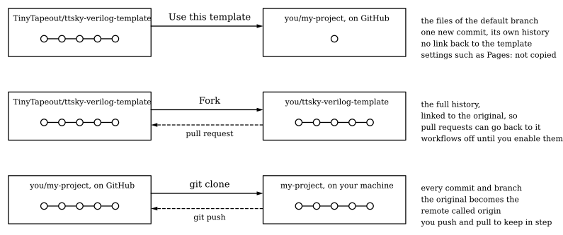
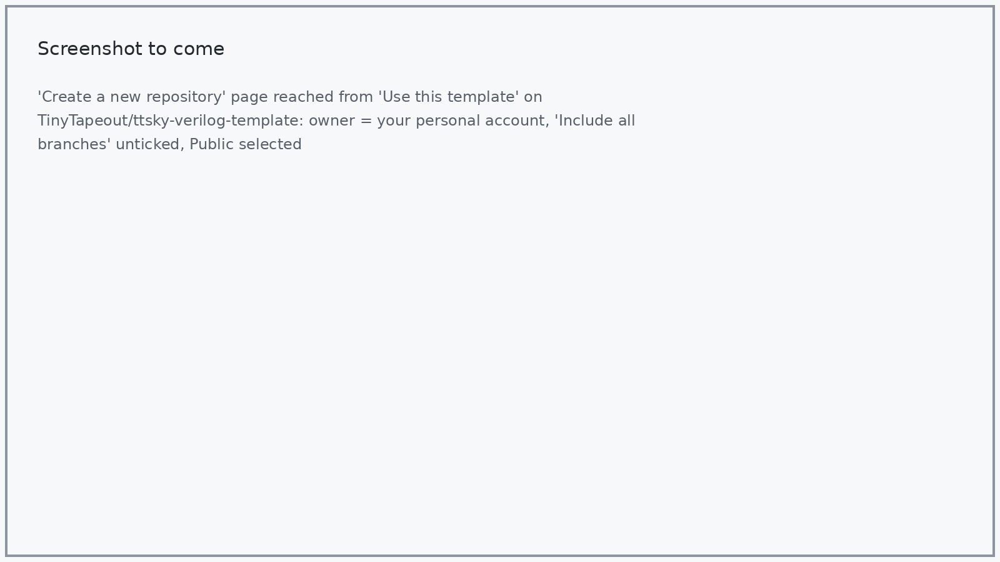
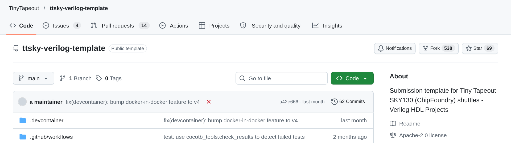

# Templates, forks and clones

This page answers: *what do you actually get when you make a repository from Tiny Tapeout's
template, how is that different from a fork or a clone, and what is still missing afterwards?*

Every Tiny Tapeout project starts the same way. Someone presses **Use this template** on one of Tiny
Tapeout's template repositories, gets a repository of their own, and starts filling it in. It looks
like a copy of the template, but it isn't quite one, and the differences explain several of the red
crosses you'll see in the team's repositories. You'll make your own repository this way in
[Lab 01](../labs/lab-01-your-repo-from-the-template-overview.md).

## Three ways to copy a repository

GitHub and git give you three different kinds of copy, and each takes a different amount from the
original:

{width=760 fig-alt="Three rows. In the first, a box labelled TinyTapeout/ttsky-verilog-template holds a chain of five commits, and an arrow labelled Use this template points to a box labelled you/my-project, on GitHub, which holds a single commit. Notes beside it read: the files of the default branch; one new commit, its own history; no link back to the template; settings such as Pages: not copied. In the second row an arrow labelled Fork points from the template to you/ttsky-verilog-template, which holds the same five commits, and a dashed arrow labelled pull request points back. Notes: the full history, linked to the original, so pull requests can go back to it; workflows off until you enable them. In the third row an arrow labelled git clone points from you/my-project, on GitHub, to my-project, on your machine, which holds the same five commits, and a dashed arrow labelled git push points back. Notes: every commit and branch; the original becomes the remote called origin; you push and pull to keep in step."}

**Use this template** makes a new repository that starts with the template's files and nothing
else. GitHub's documentation puts it this way: the new repository gets "the same directory
structure, branches, and files", by default only the default branch, and "a repository created
from a template starts with a single commit", with a history unrelated to the template's
([creating a repository from a template](https://docs.github.com/en/repositories/creating-and-managing-repositories/creating-a-repository-from-a-template)).
That single commit is the whole of your project's past, and nothing in your repository's history
connects it to the template's.

<!-- SCREENSHOT-TODO: The "Create a new repository" page reached from "Use this template" on TinyTapeout/ttsky-verilog-template, signed in, with Owner set to a personal account, "Include all branches" unticked and Public selected. -->
{width=640}

The template itself has a much longer past. This is Tiny Tapeout's digital template on Nov 15,
2026, seen without signing in:

{width=760 fig-alt="The repository page for TinyTapeout/ttsky-verilog-template, labelled Public template, with 538 forks and 69 stars. It shows the main branch, 1 branch, 0 tags and 62 commits. The latest commit is a42e666, fix(devcontainer): bump docker-in-docker feature to v4."}

None of its 62 commits come with it when you use it; your repository starts with one commit of its
own.

A **fork** is a copy that stays linked to the original. It keeps the history, and because GitHub
remembers the link, you can open a pull request from your fork back to the original repository.
That's how you contribute to a project you can't push to, such as Tiny Tapeout's own template,
or, in Lab 04, your partner's repository.
Forks have one surprise for this course: "Workflows don't run in forked repositories by default"
([events that trigger workflows](https://docs.github.com/en/actions/reference/workflows-and-actions/events-that-trigger-workflows)),
so a fork of a Tiny Tapeout repository won't check anything until you turn Actions on in it.

A **clone** is a copy on your own machine, made with `git clone`. It has every commit and branch,
and the repository you cloned from becomes the remote called `origin`, which is where your pushes
go. You'll clone every repository you work on, whichever way it was created.

For your own project, you use the template. You fork when you want to propose a change to somebody
else's repository, and you clone whenever you want to work on a repository at all.

## What the template gives you

The digital template, `TinyTapeout/ttsky-verilog-template`, gives you these files:

| Path | What it's for |
|---|---|
| `info.yaml` | Your project's title, author, top module, tile size, clock and pinout |
| `docs/info.md` | The text of your page in the datasheet |
| `src/project.v`, `src/config.json` | An example design (an adder) and the LibreLane settings |
| `test/` | A cocotb testbench (`tb.v`, `test.py`), its `Makefile` and `requirements.txt` |
| `.github/workflows/` | Four workflows: `docs`, `test`, `gds` and `fpga` (`fpga` is switched off with `branches: none`) |
| `.devcontainer/` | A container definition, with the template's tools, for VS Code's dev containers |
| `LICENSE` | Apache-2.0 |
| `README.md` | Badges for the workflows, and links to Tiny Tapeout's guides |

The analog template, `TinyTapeout/ttsky-analog-template`, is smaller. It has only two workflows,
`docs` and `gds`, and its `src/project.v` is an empty module that declares the power and signal
pins your layout must provide. There's no example design, because the design is the layout you
draw, and the `gds` workflow expects to find it already in the repository. If you're joining the
team's ASIC Zoo, you'll start from `asic-zoo-template`, which was itself made from Tiny Tapeout's
analog template and is marked as a template in its own right.

What the template doesn't give you is its settings. Every `gds` workflow ends with a job called
`viewer`, which publishes your layout through GitHub Pages so that Tiny Tapeout's 3D viewer can show
it, and Pages is switched off in a new repository. When we checked on Nov 15, 2026, Pages was off in `protocol-emulator`,
`hart-1`, `crosswalk` and `asic-zoo-template`, all of them made from a template, and the viewer job
had failed in every `gds` run they'd made. (Pages has since been turned on in all four.) GitHub's
documentation doesn't say which settings a template passes on, but these four repositories show
that Pages isn't one of them.
[Reading a workflow file](reading-a-workflow-file.md#github-pages-and-the-viewer) shows what the
failure looks like and how it's fixed.

## The placeholders you have to replace

The template is meant to be filled in, and its checks fail until you do. Two files matter most.

`info.yaml` arrives with its title, author and description empty, its pinout blank and its top
module set to `tt_um_example`. Tiny Tapeout's validator, `project_info.py` in `tt-support-tools`,
reads it on every push and rejects, among other things, an empty title, author, description or
language, a top module whose name doesn't start with `tt_um_`, a missing or non-integer `clock_hz`,
`analog_pins` outside 0 to 6, `uses_vapwr` set without an analog pin, an empty pinout, and any pin
added to or deleted from the pinout. The comments in the template's own `info.yaml` say the same
things in plainer words ("DO NOT delete or add any pins"), and they're worth reading line by line.

`docs/info.md` arrives with two sections, "How it works" and "How to test", each holding a sentence
of placeholder text. The docs check (`project_checks.py`) doesn't look for the headings. It looks
for the placeholder sentences themselves, `Explain how your project works` and `Explain how to use
your project`, under those headings, and reports the section as missing if it finds them.

`hart-1` shows both checks at work. Its `info.yaml` still has the template's empty fields, and its
`docs/info.md` is identical to the template's. Here is the end of the docs job from its run on
Nov 15, 2026 ([run 43752267314](https://github.com/uoftasic/hart-1/actions/runs/43752267314)):

```
## Errors in info.yaml
- Project title cannot be empty
- Project author cannot be empty
- Project description cannot be empty
- Please fill in the 'pinout' section

## Errors in docs/info.md
- Missing 'How it works' section in docs/info.md
- Missing 'How to test' section in docs/info.md
```

Both sections exist in that file; they're reported as missing because they still hold the
template's sentence. The `docs` and `gds` workflows in `hart-1` have failed on every push since its
first commit on Oct 18, 2026, while `test` has passed every time, because its test is still the
template's own test of the template's adder.

Everything you put in `info.yaml` ends up in public: in the repository, and in the datasheet that
the docs workflow builds. The `author` field and the optional `discord` field are yours to choose,
and [How open-source projects work](how-open-source-projects-work.md#working-in-public) says more
about what that means.

## Template updates

Tiny Tapeout updates its templates for every shuttle. The digital template's history has a commit
called "chore: update tags for …" for each one: TTSKY25a (Jun 27, 2025), TTSKY25b (Sep 18, 2025),
TTSKY26a (Feb 27, 2026), TTSKY26c (May 26, 2026) and TTSKY26d (Sep 15, 2026). Each of those commits
changes the tag at the end of every `uses: TinyTapeout/tt-gds-action/…@…` line, which picks the
version of Tiny Tapeout's actions your workflows run.

Your repository doesn't get those updates, because its history is unrelated to the template's and
git has no common commit to merge from. Each of the team's repositories is therefore frozen at the
tag it was made with: `ttsky25b` in `simproc` and `dpll`, `ttsky26a` in `ttsky-verilog-tinyCGRA`,
`ttsky26d` in `hart-1`, `sentry`, `crosswalk` and `asic-zoo-template`, and `ttihp26b` in
`protocol-emulator`. That's usually what you want, since a project that worked last week keeps
working. When a project does need a newer template's workflows, Tiny Tapeout's
[FAQ](https://tinytapeout.com/faq/) says to copy the new template's files over the old ones, and
that they "should replace anything in `.github/workflows`, `.devcontainer` and `test/Makefile`".
Doing that is outside this course, but it helps to know why it's a copy and not a merge.

## Check yourself

1. You make a repository from the digital template and clone it. How many commits does `git log`
   show, and how many does the template have?

<details>
<summary>Answer</summary>

One commit, the "Initial commit" GitHub made when it created your repository. The template had 62
when we looked on Nov 15, 2026, and none of them come with it, because a repository made from a
template starts with a single commit and a history of its own.

</details>

2. Your docs workflow reports `Missing 'How to test' section in docs/info.md`, but you can see a
   `## How to test` heading in the file. What's wrong?

<details>
<summary>Answer</summary>

The placeholder sentence `Explain how to use your project` is still under the heading. The check
looks for that sentence, not for the heading, so replace it with a real description of how to test
your design.

</details>

3. You've found a mistake in a comment in Tiny Tapeout's template and want to propose a fix. Do you
   use the template, fork it, or clone it?

<details>
<summary>Answer</summary>

Fork it (and then clone your fork to edit it). A fork keeps the link to the original repository,
which is what lets you open a pull request back to it. A repository made with "Use this template"
has no such link.

</details>

4. Why does the `viewer` job fail on the first push to a repository made from the template, even
   when nothing else is wrong?

<details>
<summary>Answer</summary>

It deploys to GitHub Pages, and Pages is a repository setting. The template passes on its files but
not its settings, so Pages is off in the new repository until you turn it on, and the job passes
only in a run started after that.

</details>

Next: [Lab 01](../labs/lab-01-your-repo-from-the-template-overview.md), where you make your own
repository from the template.
