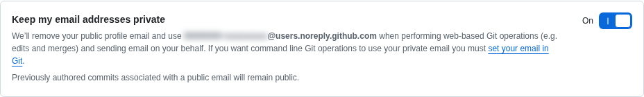
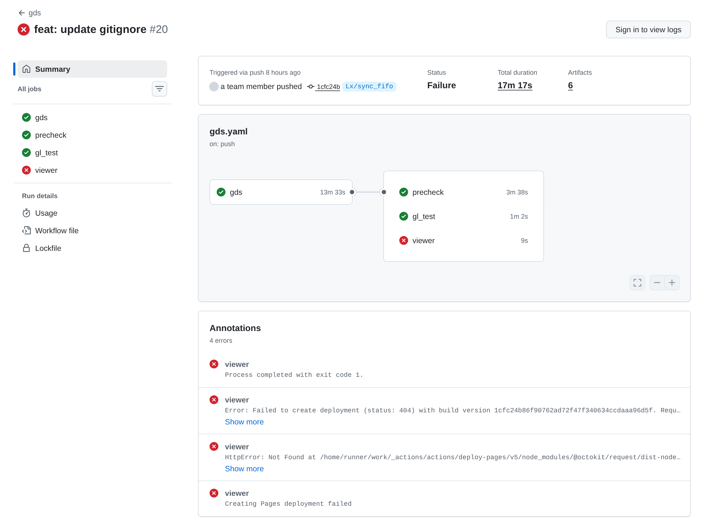
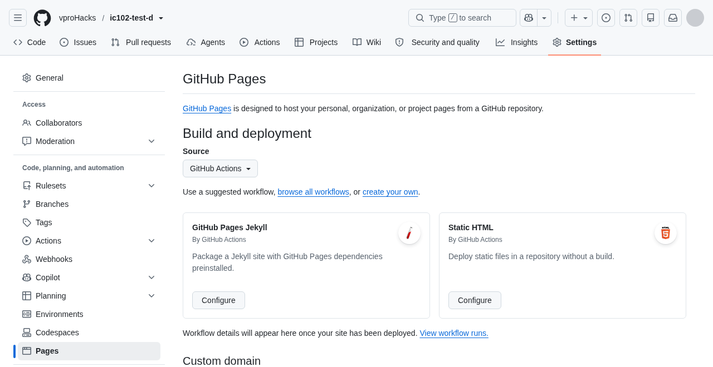
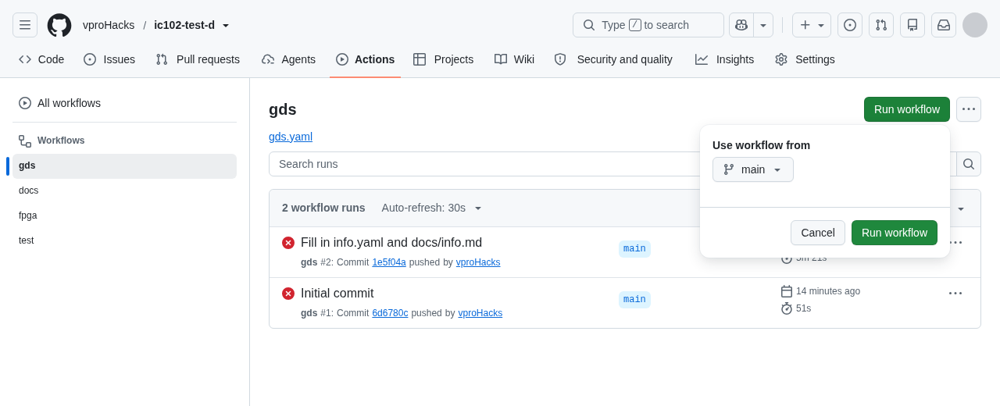
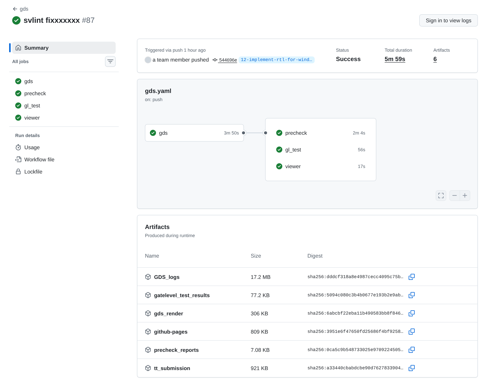

# Lab 01: Your repository from the template

You'll make a Tiny Tapeout project of your own: a public repository on your GitHub account,
created from Tiny Tapeout's Verilog template. You'll fill in the two files the template leaves
for you, push, read what each workflow says, turn on GitHub Pages when the last job asks for it,
and keep going until every job is green on a commit you made. You'll also install the test job's
tools in the workbench, which the later labs use.

Package: [`labs/lab-01-your-repo-from-the-template/`](https://github.com/uoftasic/ic102-d/tree/main/labs/lab-01-your-repo-from-the-template)

## Before you start

- Read [Getting started](../guide/getting-started.md), [Git in one page](../guide/git-in-one-page.md)
  and [Templates, forks and clones](../guide/templates-forks-and-clones.md).
- You need a GitHub account of your own. Any account works; the course doesn't use the team's
  GitHub organization.
- You need the workbench from [IC101](https://uoftasic.com/ic101/). Every command in this course
  runs in a terminal on its desktop, git included; [Getting started](../guide/getting-started.md#where-you-run-git)
  explains why.

This lab takes about an hour, of which about 15 minutes is waiting for GitHub's runners.

## Part 1: Load the course

If you haven't set up the workbench yet, do
[IC101 Lab 03](https://uoftasic.com/ic101/labs/lab-03-launch-the-workbench-overview.html) first.

1. From your `workspace` clone, start the desktop (`./scripts/start_vnc.sh`, or
   `scripts\start_vnc.bat` on Windows), open <http://localhost/>, and open a terminal on the
   desktop.

2. Load the environment and get the course files:

   ```bash
   . /foss/designs/common/.designinit   # in every new terminal
   mod add ic102-d                      # first time only: clones github.com/uoftasic/ic102-d
   mod ic102-d                          # every time, including the first
   ```

   You should see the `ASIC-EDU: PDK=sky130A ...` banner and, at the end,
   `cwd: /foss/designs/modules/ic102-d`.

   <!-- RUN-TODO: the output of `mod add ic102-d` once github.com/uoftasic/ic102-d exists (add_module.sh's "Cloning ..." and "OK  module ready: ..." lines). -->

3. Install the test job's tools. GitHub's runner tests your design with Icarus Verilog 12.0 and
   cocotb 2.1.0, and the workbench has 14.0 and 2.0.1, so the course installs the runner's
   versions next to the workbench's, in the course folder:

   ```bash
   cd labs/common/tt-tools
   make install
   make check-tools
   ```

   `make install` took 5 s on a fast connection and puts 177 MB on your own disk, so it survives
   a restart of the container. You should see this table:

   ```
   Tool (job)             Runner         Here           Workbench      Status
   ----------             ------         ----           ---------      ------
   Python (test)          3.11.18        3.11.16        3.12.3         ok (3.11)
   cocotb (test)          2.1.0          2.1.0          2.0.1          ok
   pytest (test)          8.4.2          8.4.2          9.1.1          ok
   Icarus (test)          12.0           12.0           14.0           ok
   Icarus (gl_test)       13.0           13.0           14.0           ok
   sky130A (gl_test)      8afc8346a57f   -              026824c7969c   not installed (optional)
   LibreLane (gds)        3.0.14         -              3.1.0.dev3     not installed: the gds job runs on GitHub

   All pinned tools are installed at the runner's versions.
   ```

4. Run the template's own test the way the runner's test job does:

   ```bash
   make selftest
   ```

   You should see, after about 3 s, `** test.test_project PASS 100000.00` and
   `** TESTS=1 PASS=1 FAIL=0 SKIP=0`. [Your tools and the runner's tools](../guide/your-tools-and-the-runners-tools.md)
   explains the versions, and the [package README](https://github.com/uoftasic/ic102-d/tree/main/labs/common/tt-tools)
   has the details.

| If you see | Do this |
|---|---|
| `make install` stops partway with a download error | Run `make install` again; it skips the parts that finished. |
| `fatal: detected dubious ownership in repository` | The clone was made on your laptop, and the container's user doesn't own it. Clone again from the workbench terminal. |
| Anything else | IC101's [Troubleshooting](https://uoftasic.com/ic101/reference/troubleshooting.html) |

## Part 2: Your identity and your token

What will your commits say about you, and how will git prove to GitHub that it's you pushing?

1. Find your GitHub no-reply address. On GitHub, open **Settings › Emails**, tick **Keep my email
   addresses private**, and copy the address shown under it, which looks like
   `ID+USERNAME@users.noreply.github.com`.

   {width=640}

   Every commit records an email address, and in a public repository anyone can read it. Four of
   the team's repositories already show personal addresses in their history; using the no-reply
   address keeps yours out. You'll set it in each repository you clone, in Part 3.

2. Make a token for git to push with. GitHub doesn't accept your password from git, so on GitHub
   open **Settings › Developer settings › Personal access tokens › Fine-grained tokens**, choose
   **Generate new token**, and give it:

   - the name `IC102 workbench`, your own account as the resource owner, and an expiry of 60 days;
   - **All repositories** under Repository access, because the repositories for Labs 04 and 05
     don't exist yet;
   - two repository permissions, **Contents** and **Workflows**, both "Read and write". Contents
     is what a push needs, and GitHub refuses a push that adds or changes a file under
     `.github/workflows/` without Workflows, which two pushes in Labs 04 and 05 do. GitHub adds
     Metadata, read-only, by itself.

   Copy the token when GitHub shows it, because GitHub shows it only once. Keep it in your
   password manager. A file in your workspace is a bad place for it, because the workspace is a
   git clone and a file there can end up in a commit.
   [Getting started](../guide/getting-started.md#where-you-run-git) says why the course uses this
   kind of token and not a classic one.

   <!-- SCREENSHOT-TODO: github.com/settings/personal-access-tokens/new, signed in: a fine-grained token named "IC102 workbench", Resource owner the student's own account, Expiration 60 days, Repository access "All repositories", and Repository permissions with Contents and Workflows set to "Read and write". The same capture can serve IC102-A. -->
   {width=640}

   <!-- RUN-TODO: test the token from the workbench: a push to the student's own repository, the first push of the Lab 04 sandbox copy (workflow files) to a new empty repository, a branch push to the student's fork; and quote GitHub's refusal when Workflows is left out. -->

You should see: a no-reply address and a token, both copied somewhere safe.

## Part 3: Make the repository

What does the template give you, and what will its workflows say about it before you've changed
anything?

1. Open <https://github.com/TinyTapeout/ttsky-verilog-template>, press **Use this template ›
   Create a new repository**, and set the owner to your own account. Name it `ttsky-ic102-d`,
   choose **Public**, and leave **Include all branches** unticked. (The labs use that name in
   their commands; another name works if you change it there too.)
   It must be public: GitHub's runners are free on public repositories, and Pages, which the last
   job needs, is available on a free account only for public ones.

   {width=640}

2. GitHub makes the repository and commits the template's files to it, and that commit is a push,
   so the workflows have already started. Before you look, predict which of the three workflows
   (`docs`, `test` and `gds`) pass on this first commit.

3. Clone the repository into the `projects` folder of your workspace, and set your identity and
   token cache for it:

   ```bash
   mkdir -p /foss/designs/projects && cd /foss/designs/projects
   git clone https://github.com/YOUR-USERNAME/ttsky-ic102-d.git
   cd ttsky-ic102-d
   git config user.name "Your Name"
   git config user.email "ID+USERNAME@users.noreply.github.com"
   git config credential.helper 'cache --timeout=28800'
   ```

   Put your username, your name and the no-reply address from Part 2 in place of the
   placeholders. These three settings go in this clone's `.git/config`, which is on your own
   disk. Settings made with `--global` would be lost the next time the container starts, so
   you'll make the same three settings in every clone in this course.

4. Look at what came with the template:

   ```bash
   git log --oneline
   ls .github/workflows
   grep -rn "uses: TinyTapeout" .github/workflows
   ```

   You should see one commit, `Initial commit`, the four workflow files
   `docs.yaml fpga.yaml gds.yaml test.yaml`, and six lines ending in the same tag:

   ```
   .github/workflows/fpga.yaml:19:        uses: TinyTapeout/tt-gds-action/fpga/ice40up5k@ttsky26d
   .github/workflows/gds.yaml:17:        uses: TinyTapeout/tt-gds-action@ttsky26d
   .github/workflows/gds.yaml:26:        uses: TinyTapeout/tt-gds-action/precheck@ttsky26d
   .github/workflows/gds.yaml:38:        uses: TinyTapeout/tt-gds-action/gl_test@ttsky26d
   .github/workflows/gds.yaml:47:      - uses: TinyTapeout/tt-gds-action/viewer@ttsky26d
   .github/workflows/docs.yaml:17:        uses: TinyTapeout/tt-gds-action/docs@ttsky26d
   ```

   `ttsky26d` names the version of Tiny Tapeout's actions your repository uses. Your repository
   keeps that tag whatever Tiny Tapeout does to its template later, although Tiny Tapeout can move
   the tag itself to a new commit, as [The Tiny Tapeout workflows](../guide/the-tiny-tapeout-workflows.md#tags-and-support-tools-that-move)
   explains.

5. Now open your repository's **Actions** tab and compare it with your prediction.

   <details>
   <summary>Answer</summary>

   `test` passes, and `docs` and `gds` fail. `test` runs the template's own test of the
   template's adder, which is correct. `docs` and `gds` both read `info.yaml`, whose title,
   author and description are empty. In `gds` only the first job runs, and the other three are
   skipped because each `needs: gds`. `hart-1`'s first commit, made from the same template on
   Oct 18, got exactly this. Its check runs, read with the course's `check-runs.py`:

   ```
   uoftasic/hart-1 at 29313b4
     docs      failure
     test      success
     gds       failure
     precheck  skipped
     gl_test   skipped
     viewer    skipped
   ```

   </details>

You should see: one commit in your clone, and one green and two red workflows on GitHub.

## Part 4: Fill it in

Which of the six jobs pass once `info.yaml` and `docs/info.md` are filled in?

1. Edit `info.yaml`, reading each comment as you go. Fill in `title`, `author` (whatever name you
   want public; it ends up in the datasheet), `description`, and the pinout. The design is still
   the template's adder, which adds `ui_in` and `uio_in` and puts the sum on `uo_out`, so name the
   pins for that, for example `ui[0]: "a[0]"`, `uio[0]: "b[0]"` and `uo[0]: "sum[0]"`. Leave
   `top_module`, `tiles` and `clock_hz` as they are. Don't add or delete any pins.

2. Edit `docs/info.md`. Replace the sentence under "How it works" and the one under "How to
   test" with a few real sentences each: the docs check fails while the template's sentences are
   still there.

3. Commit and push. The first push asks for your GitHub username, and then for a password: paste
   the token there. The cache remembers it for 8 hours.

   ```bash
   git add info.yaml docs/info.md
   git commit -m "Fill in info.yaml and docs/info.md"
   git push
   ```

4. Predict the result of each job before you look: `docs`, `test`, and the four jobs of `gds`.
   `gds` builds the layout this time, which took 3 to 4 minutes for `sentry`, a 2x2 design, and
   the three jobs after it take another few minutes.

   <details>
   <summary>Answer</summary>

   Five pass and `viewer` fails. `viewer` publishes your layout with GitHub Pages, and Pages is off
   in a repository made from a template. It's what kept `protocol-emulator`'s `gds` runs red: in
   the two of its runs we checked, the layout built, precheck passed, and only `viewer` failed.

   </details>

5. Open the `viewer` job's log (signed in) and find the line that says what to do. In
   `protocol-emulator`'s run [43757724629](https://github.com/uoftasic/protocol-emulator/actions/runs/43757724629)
   it was:

   ```
   ##[error]Error: Failed to create deployment (status: 404) with build version 1cfc24b86f90762ad72f47f340634ccdaaa96d5f. Request ID 5018:223A0C:13B2E1A:3F3E2A0:6AFA17C5 Ensure GitHub Pages has been enabled: https://github.com/uoftasic/protocol-emulator/settings/pages
   ```

   Yours names your repository's own settings page.

   {width=760}

You should see: `docs` and `test` green, and in `gds` everything green except `viewer`, with
the 404.

## Part 5: Turn on Pages

How do you fix a failure that isn't in any file?

1. On GitHub, open your repository's **Settings › Pages**, and under **Build and deployment ›
   Source**, choose **GitHub Actions**.

   {width=640}

2. Start a new run of the `gds` workflow: on the **Actions** tab, choose **gds** in the list of
   workflows, then **Run workflow** on the right, and run it on `main`. (Pushing a new commit
   would start a new run too.)

   <!-- SCREENSHOT-TODO: the Actions tab of a student's repository, signed in, with the gds workflow selected and the "Run workflow" menu open, showing "Use workflow from Branch: main" and the green "Run workflow" button. -->
   {width=640}

   Why a new run and not **Re-run failed jobs**? A re-run keeps the first attempt's Pages
   artifact, and the `viewer` action at the `ttsky26d` tag uploads one with the same name every
   attempt, so the re-run fails with "Multiple artifacts named "github-pages"". `sentry` hit
   exactly that; [Reading a workflow file](../guide/reading-a-workflow-file.md#re-running-a-run)
   has the log. A new run starts with no artifacts.

3. When the run finishes, every job should be green, as in this run of `sentry`'s:

   {width=760}

4. Open your project's page, whose address Settings › Pages now shows. It's the page Tiny
   Tapeout's 3D viewer reads your layout from.

5. Check your work:

   ```bash
   python3 /foss/designs/modules/ic102-d/labs/lab-01-your-repo-from-the-template/check.py
   ```

   It checks your files and your history, then reads your commit's jobs from GitHub's public API.
   For a commit with all six green, the table looks like this one, which the course's
   `check-runs.py` printed for `sentry`'s commit `544696e` (whose extra `lint` job comes from a
   workflow `sentry` added):

   ```
   uoftasic/sentry at 544696e
     docs      success
     test      success
     gds       success
     precheck  success
     gl_test   success
     viewer    success
     lint      success

   All six jobs passed.
   ```

   <!-- RUN-TODO: lab-01 check.py's full output on a practice repository with every job green on the student's commit (VERDICT: PASS). -->

You should see: six green jobs on your commit, and `VERDICT: PASS`.

## Finishing

You're done when `check.py` prints `VERDICT: PASS`: `info.yaml` and `docs/info.md` are filled in,
HEAD is a commit of yours on top of the template's, and all six jobs passed on it.

Questions:

1. The template's own first commit passed `test`. What did that pass tell you about the design?

   <details>
   <summary>Answer</summary>

   Very little. The test drives one pair of inputs, 20 and 30, and checks for 50, so it proves the
   adder adds those two numbers. It would pass on a design that only ever handled that one case.
   You'll write a stronger test in Lab 03.

   </details>

2. Your fix in Part 5 didn't change any file. How would someone reading your history later know
   why the `viewer` job started passing?

   <details>
   <summary>Answer</summary>

   They wouldn't, from the history alone: a setting isn't a commit, and the run logs that show
   the 404 are deleted after 90 days. That's a reason to write it down where it lasts, for
   example in the README, or in an issue.

   </details>

Submit: the link to your repository.

Next on the [Course path](../index.md#course-path): read
[What a cloud runner is](../guide/what-a-cloud-runner-is.md),
[Reading a workflow file](../guide/reading-a-workflow-file.md) and
[The Tiny Tapeout workflows](../guide/the-tiny-tapeout-workflows.md), then do
[Lab 02: Read the red X](lab-02-read-the-red-x-overview.md).
