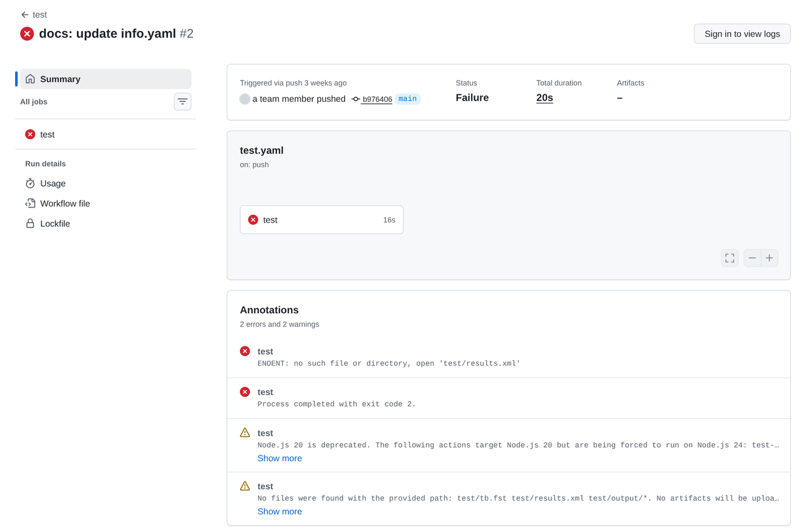

# Lab 02: Read the red X

You'll break your own repository five times, each time in a way one of the team's repositories
broke or one of Tiny Tapeout's checks exists to catch. A course script makes each breakage as one
commit. You predict what will fail, push, and find the job, the step and the first error line
that explain the red X, and you write them in a file called `DIAGNOSIS.md` before you fix
anything. Each fix is a commit of yours that GitHub runs green.

Package: [`labs/lab-02-read-the-red-x/`](https://github.com/uoftasic/ic102-d/tree/main/labs/lab-02-read-the-red-x)

## Before you start

- Read [What a cloud runner is](../guide/what-a-cloud-runner-is.md),
  [Reading a workflow file](../guide/reading-a-workflow-file.md) and
  [The Tiny Tapeout workflows](../guide/the-tiny-tapeout-workflows.md).
- Finish [Lab 01](lab-01-your-repo-from-the-template-overview.md): every job green on a commit
  of yours, with Pages on. This lab starts from that state.
- Every command runs in a terminal on the workbench desktop, in your repository's folder. In each
  new terminal, run these first:

  ```bash
  . /foss/designs/common/.designinit
  L=/foss/designs/modules/ic102-d/labs/lab-02-read-the-red-x
  cd /foss/designs/projects/ttsky-ic102-d
  ```

To read a job's log you have to be signed in to GitHub, even for your own public repository. A
run's summary page is public, and GitHub shows the logs behind it only to people who are signed in.

This lab takes about 1 hour 15 minutes, most of it waiting for runs. A `docs` or `test` run
finishes in under a minute. A `gds` run takes about 5 minutes, and you can read the next page of
this lab while it works.

## Part 1: The diagnosis file

1. Make sure your clone is up to date with GitHub and has nothing uncommitted, because the
   breakage script refuses to run otherwise:

   ```bash
   git pull
   git status
   ```

   You should see `nothing to commit, working tree clean`.

2. Copy the diagnosis template to the top of your repository and look at the breakages:

   ```bash
   cp $L/DIAGNOSIS-template.md DIAGNOSIS.md
   python3 $L/break.py --list
   ```

   You should see the five commit messages the breakages will use:

   ```
   1  info.yaml: tidy up the project section
   2  docs: start info.md again from the template's layout
   3  Rename the top module so that it's unique on the shuttle
   4  Output the difference ui_in - uio_in instead of the sum
   5  info.yaml: run the design at 50 MHz
   ```

   They read like commits a teammate might push, and like `protocol-emulator`'s
   `b976406 docs: update info.yaml`, which also renamed a module, a message doesn't always say
   everything a commit did.

3. Commit `DIAGNOSIS.md` and push it, so each entry you add later travels with its fix:

   ```bash
   git add DIAGNOSIS.md
   git commit -m "Add DIAGNOSIS.md for Lab 02"
   git push
   ```

## Part 2: Breakage 1, step by step

Which job tells you first that `info.yaml` is wrong, and which line in its log says how?

Every breakage follows the same eight steps. This part walks through them once.

1. Make the breakage:

   ```bash
   python3 $L/break.py 1
   ```

   You should see `Committed breakage 1 as <hash>: info.yaml: tidy up the project section`,
   then `Nothing has been pushed.` Don't look at the diff yet.

2. Predict, and write it in the **Prediction** field of the breakage's entry: which workflows go
   red, and which job finishes red first? You know from the commit message that `info.yaml`
   changed, and from [The Tiny Tapeout workflows](../guide/the-tiny-tapeout-workflows.md) which
   jobs read it.

3. Push, and open the Actions tab of your repository:

   ```bash
   git push
   ```

4. Find the first red job. Open its run, click the red job, and the failed step opens by itself.
   Inside a step that runs one of Tiny Tapeout's actions, the failure is in a section nested in
   it; read down from the top of the failed section to the first line that names a problem.

5. Write the **Job that failed first**, the **Step** (the workflow's step, and the action's
   section inside it if there is one) and the **First error line**, copied without its
   timestamp.

6. Only now, look at what changed (`git show`), fix it the way a teammate should have, and write
   the **Fix** in a sentence.

7. Commit the fix together with your updated `DIAGNOSIS.md`, push, and wait until every job is
   green again. Then fill in **Fix commit** with the fix's hash (`git log --oneline -1`), commit
   that small change too, and push.

8. Check your entry so far, without asking GitHub yet:

   ```bash
   python3 $L/check.py --offline
   ```

   You should see `entry filled in; fix <hash> comes after breakage <hash>` under Breakage 1.

What should breakage 1's entry say? Write yours before you open this.

<details>
<summary>Answer</summary>

Two workflows go red, `docs` and `gds`, and `docs` usually finishes first: in `hart-1`'s runs
with the same mistake, the `docs` job took 30 s and the `gds` job 54 s. `test` stays green,
because the testbench never reads `info.yaml`.

In `docs`, the step is "Build docs", section "Check info.yaml and docs/info.md", and the error is
the line under the heading:

```
## Errors in info.yaml
- Project title cannot be empty
```

That's the text tt-support-tools' docs check (the commit the runner used on Nov 16, `9d13ff3`)
printed when we ran it on a broken copy of the template in the course image.
<!-- RUN-TODO: the docs job's log for breakage 1 pushed to a practice repository, to confirm the two lines above. -->
`hart-1`'s docs log ([run 43752267314](https://github.com/uoftasic/hart-1/actions/runs/43752267314))
has the same line in a longer list, because its title, author, description and pinout were all
empty.

In `gds`, the step is "Build GDS", section "Fetch verilog and build config". In `hart-1`'s run
([43752267356](https://github.com/uoftasic/hart-1/actions/runs/43752267356)) it reads:

```
2026-11-15 19:25:32,583 - project    - ERROR    - Error loading /home/runner/work/hart-1/hart-1/info.yaml: Project title cannot be empty, Project author cannot be empty, Project description cannot be empty
```

Yours names your repository and lists only the title. The `cat: ... No such file or directory`
from "Linter output" further down is a consequence, as
[Reading a workflow file](../guide/reading-a-workflow-file.md#reading-a-failed-run) explains. The
fix is to put the title back.

</details>

You should see: Breakage 1's entry complete, and every job green on its fix commit.

## Part 3: Breakage 2

Can a section be "missing" from a file you can see it in?

1. Run `python3 $L/break.py 2` and follow the routine from Part 2.

   <details>
   <summary>Answer</summary>

   Only `docs` fails, in the same section as breakage 1, with:

   ```
   ## Errors in docs/info.md
   - Missing 'How it works' section in docs/info.md
   - Missing 'How to test' section in docs/info.md
   ```

   Those are the last two lines of `hart-1`'s docs log too. The script put the template's
   `docs/info.md` back, and both headings are there; the check looks for the template's
   placeholder sentences under them ("Explain how your project works") and reports the section
   as missing while they're still there. `gds` passes, because only the docs check reads
   `docs/info.md`.

   The fix is to write the two sections again, or to undo the commit: `git revert HEAD` makes a
   new commit that undoes the last one and leaves the history intact.

   </details>

You should see: `docs` red with the two "Missing" lines, and green again after your fix.

## Part 4: Breakage 3

What does a test do when the design it tests has a new name?

1. Run `python3 $L/break.py 3` and follow the routine. This one fails in two workflows a few
   minutes apart, so wait for both before you write the entry.

   {width=760 fig-alt="A workflow run summary for test.yaml on commit b976406, docs: update info.yaml, status Failure, total duration 20s. The single test job is red after 16s. The Annotations box lists 2 errors and 2 warnings: ENOENT: no such file or directory, open 'test/results.xml'; Process completed with exit code 2; a warning that Node.js 20 is deprecated; and No files were found with the provided path: test/tb.fst test/results.xml test/output/*."}

   That's `protocol-emulator`'s run for the same mistake, seen without signing in. None of its
   annotations says what's wrong.

   <details>
   <summary>Answer</summary>

   The script renamed the top module in `src/project.v` and in `info.yaml`, to
   `tt_um_<your username>_adder`, and left `test/tb.v` instantiating `tt_um_example`. `test`
   fails first, in "Run tests". This is `protocol-emulator`'s line for the same mistake
   ([run 40123836544](https://github.com/uoftasic/protocol-emulator/actions/runs/40123836544)):

   ```
   /home/runner/work/protocol-emulator/protocol-emulator/test/tb.v:27: error: Unknown module type: tt_um_example
   ```

   Yours names your repository and says `tb.v:31`, the line of the current template's `tb.v`
   that names the module. Our run of the breakage with the course's `make test` and Icarus 12.0
   printed `/foss/designs/projects/ttsky-ic102-d/test/tb.v:31: error: Unknown module type: tt_um_example`.
   Then `gds` goes red too, but
   only in `gl_test`, which runs the same testbench on the netlist: in `protocol-emulator`'s run
   [41345900293](https://github.com/uoftasic/protocol-emulator/actions/runs/41345900293) the
   `gds` and `precheck` jobs passed and `gl_test` stopped at the same `Unknown module type`
   line. The `results.xml` and `tb.fst` messages after it, and in the annotations, are
   consequences: the simulation never started.

   The fix is the one line in `test/tb.v` that names the module, not undoing the rename: the
   template asks for a top module with your username in it.

   </details>

You should see: `test` and `gl_test` red with `Unknown module type`, and green after the fix.

## Part 5: Breakage 4

When a test fails because the design changed on purpose, what's the right fix?

1. Run `python3 $L/break.py 4` and follow the routine, but stop before you fix it and answer the
   question in step 2 first.

   <details>
   <summary>Answer: the error</summary>

   `test` fails in "Run tests", and later `gl_test` fails in the same way. With the course's
   `make test` the failure reads:

   ```
   AssertionError: assert LogicArray('11110110', Range(7, 'downto', 0)) == 50
   ```

   <!-- RUN-TODO: the test job's and gl_test's logs for breakage 4 pushed to a practice repository, to confirm the AssertionError line on the runner. -->

   The template's test drives 20 and 30 and expects their sum, 50. The design now subtracts,
   and $20 - 30 = -10$, which is `11110110`, or 246, in eight bits.

   </details>

2. The commit says the design should output the difference now. `protocol-emulator` once had a
   failing assertion and commented it out (`a5f1475`, "chore: temporarily remove assertion from
   test.py"), and its test has passed ever since while checking nothing. What should you do
   instead?

   <details>
   <summary>Answer</summary>

   Change the test to expect the new behaviour, and make it stronger while you're there. Expect
   246 for 20 − 30, and add a second case the other way round (30 − 20 = 10), so that a
   subtraction with its operands swapped can't pass. In our run that version passed with
   `test.test_project PASS 110000.00`. A fix that deletes the assertion turns the cross green
   and leaves you with a test that can't fail.

   </details>

3. Make that fix, run it locally before you push, then finish the routine:

   ```bash
   make -C /foss/designs/modules/ic102-d/labs/common/tt-tools test PROJECT="$PWD"
   ```

You should see: your strengthened test passing locally, and `test` and `gds` green on GitHub.

## Part 6: Breakage 5

What does Tiny Tapeout's validator accept for `clock_hz`?

1. Run `python3 $L/break.py 5` and follow the routine.

   <details>
   <summary>Answer</summary>

   `docs` and `gds` fail, in the same places as breakage 1. The docs check prints:

   ```
   ## Errors in info.yaml
   - Invalid value for 'clock_hz' in 'project' section, must be an integer
   ```

   That's from our run of tt-support-tools `9d13ff3` on the same `info.yaml`, in the course image.
   <!-- RUN-TODO: the docs and gds logs for breakage 5 pushed to a practice repository, to confirm the line above and the gds job's "Error loading ...info.yaml: Invalid value for 'clock_hz'..." line. -->
   `50MHz` reads as text in YAML, and the field wants a whole number of hertz. The fix is
   `clock_hz: 50000000`, or the number your design really runs at.

   </details>

2. Fill in the last section of `DIAGNOSIS.md`, "A value no workflow catches": a value you could
   put in `info.yaml` that every workflow accepts and that is still wrong, and why the workflows
   accept it.

   <details>
   <summary>Answer</summary>

   `clock_hz: 50` is one. It's an integer, so the validator accepts it, but it says the design
   runs at 50 Hz, a factor of a million below the 50 MHz the commit message meant.
   `protocol-emulator`'s pull request #2 points out exactly this value. Another is a pinout that
   calls `uio[0]` an input while the design drives it with `uio_oe[0] = 1`.

   </details>

You should see: five entries, each followed by a green fix, and the extra section filled in.

## Finishing

You're done when `python3 $L/check.py` prints `5 of 5 breakages diagnosed and fixed` and
`VERDICT: PASS`: every entry in `DIAGNOSIS.md` is filled in, each fix commit comes after its
breakage, and GitHub ran all six jobs green on every fix.

<!-- RUN-TODO: check.py's output (without --offline) on a practice repository with all five breakages fixed. -->

Questions:

1. In breakages 1 and 5, `docs` and `gds` both failed. Why does Tiny Tapeout check `info.yaml`
   in two workflows?

   <details>
   <summary>Answer</summary>

   They use it for different things. `docs` builds the datasheet page from it, and `gds` needs
   the top module, the source files and the tile size to build the layout, so each reads it and
   stops when it can't. You'd see the same error twice, and fixing it once fixes both.

   </details>

2. Which breakage would have gone unnoticed by a teammate who only ever runs the test locally?

   <details>
   <summary>Answer</summary>

   Breakages 1, 2 and 5. The local test never reads `info.yaml` or `docs/info.md`; only the
   runner's `docs` and `gds` jobs do. That's one reason the runner, not your workbench, is
   where a check counts.

   </details>

Submit: the link to your repository's `DIAGNOSIS.md` on GitHub.

Next on the [Course path](../index.md#course-path): read
[RTL and gate-level tests](../guide/rtl-and-gate-level-tests.md) and
[Your tools and the runner's tools](../guide/your-tools-and-the-runners-tools.md), then do
[Lab 03: Make it yours](lab-03-make-it-yours-overview.md).
