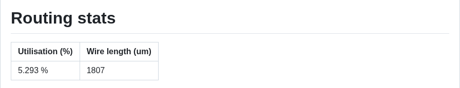
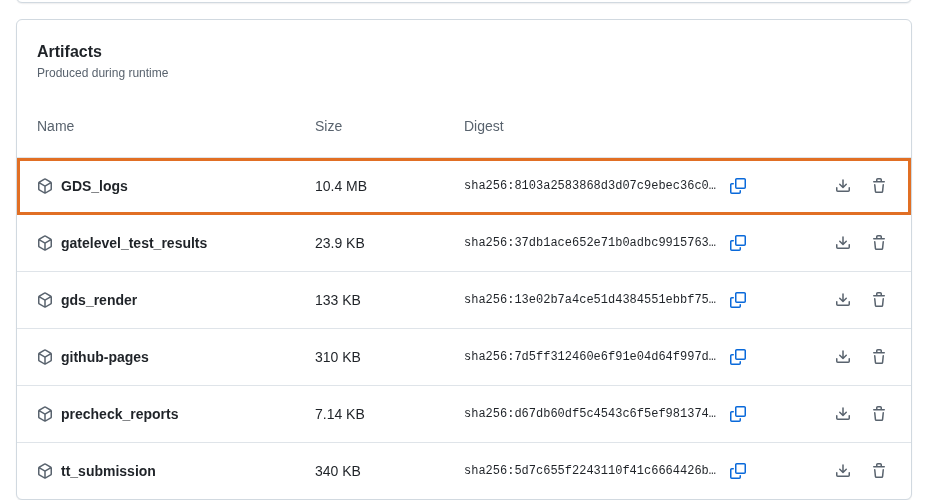

# Lab 03: Make it yours

You'll replace the template's adder with an 8-bit counter the course supplies, which means
changing the five places that name a design and getting all of them to agree. Then you'll write a
cocotb test that catches a one-line bug in the counter, run it with the test job's own tools in
the workbench, and push the bug and its fix so the runner shows you the same failure and the same
recovery. Last, you'll find where the `gds` job's routing numbers come from in the files it
uploads.

Package: [`labs/lab-03-make-it-yours/`](https://github.com/uoftasic/ic102-d/tree/main/labs/lab-03-make-it-yours)

## Before you start

- Read [RTL and gate-level tests](../guide/rtl-and-gate-level-tests.md) and
  [Your tools and the runner's tools](../guide/your-tools-and-the-runners-tools.md).
- Finish [Lab 02](lab-02-read-the-red-x-overview.md), so your repository is green again.
- Every command runs in a terminal on the workbench desktop. In each new terminal, run these
  first:

  ```bash
  . /foss/designs/common/.designinit
  L=/foss/designs/modules/ic102-d/labs/lab-03-make-it-yours
  TT=/foss/designs/modules/ic102-d/labs/common/tt-tools
  cd /foss/designs/projects/ttsky-ic102-d
  ```

The counter is in `$L/counter.v`, and the comment at its top says what each pin does. You don't
need to write Verilog in this lab, but read the file once; it's 50 lines.

This lab takes about 1 hour 30 minutes, including three `gds` runs of about 5 minutes each,
plus 20 minutes for the optional part.

## Part 1: Put the counter in

Which files name your design, and what happens when one of them disagrees?

1. Copy the counter in place of the adder:

   ```bash
   cp $L/counter.v src/counter.v
   git rm -q src/project.v
   cp $L/test_counter.py test/test.py
   ```

2. Make the five names agree. Tiny Tapeout wants a top module that starts with `tt_um_` and
   includes your GitHub username, so pick `tt_um_<username>_counter`, with any `-` in your
   username changed to `_` (Verilog names can't contain `-`). Then:

   - in `src/counter.v`, rename `module tt_um_ic102_counter` to your name;
   - in `info.yaml`, set `top_module` to it, and change `source_files` to list `counter.v`
     instead of `project.v`;
   - in `test/Makefile`, set `PROJECT_SOURCES = counter.v`;
   - in `test/tb.v`, put your module name on the line that names the module (Lab 02's breakage 3
     was this line).

3. Describe the counter. In `info.yaml`, change the title and description, set
   `clock_hz: 10000000` (the test runs a 10 MHz clock), and fill in the pinout from the comment
   in `counter.v`: `ui[0]` is `EN`, `ui[1]` is `LOAD`, `ui[2]` is `DOWN`, `uo[0]` to `uo[7]` are
   the count, and `uio[0]` to `uio[7]` are the load value. Rewrite both sections of
   `docs/info.md` for the counter.

4. Check that the names agree:

   ```bash
   python3 $L/check.py --offline
   ```

   You should see all five in agreement. Ours read:

   ```
   Names
     top_module in info.yaml    tt_um_student_counter
     source_files in info.yaml  counter.v
     PROJECT_SOURCES            counter.v
     module tb.v instantiates   tt_um_student_counter
     clock_hz                   10000000
   ```

   followed by a History section with no bug commit yet, a `todo:` line about it, and
   `VERDICT: not yet`. That's expected at this stage: Part 3 makes those commits. If a name
   disagrees, the check says which, in another `todo:` line.

5. Run the test the way the test job runs it:

   ```bash
   make -C "$TT" test PROJECT="$PWD"
   ```

   You should see `Running on Icarus Verilog version 12.0 (stable)` and
   `Initialized cocotb v2.1.0` near the top, the same two lines the runner prints, and:

   ```
   ** test.test_reset                PASS         450.00           0.00     441401.93  **
   ** test.test_count_up             PASS        1450.00           0.00    2599614.96  **
   ** TESTS=2 PASS=2 FAIL=0 SKIP=0               1900.00           0.00     916311.41  **
   ```

   The `SIM TIME` column is exact; the other two measure your computer.

6. Commit and push, then predict which jobs will pass before you open the Actions tab:

   ```bash
   git add -A
   git commit -m "Replace the adder with an 8-bit counter"
   git push
   ```

   <details>
   <summary>Answer</summary>

   All six, if the names agree. `gds` builds a new layout from `counter.v`, `gl_test` runs the
   two tests on that layout's netlist, and `docs` checks the new `info.yaml`. The test reads only
   the pins and samples them on the falling clock edge, so it doesn't depend on any name inside
   the design, which the netlist doesn't keep.

   </details>

You should see: two passing tests locally, and six green jobs on GitHub.

## Part 2: A test that catches the bug

What does a test need to catch a one-line bug?

1. Put the course's bug into your counter, without committing it, and look at it:

   ```bash
   python3 $L/bug.py apply
   git diff src/counter.v
   ```

   You should see:

   ```
   src/counter.v: the load line now reads `count <= ui_in;` (not committed; see it with git diff)
   ```

   and a diff of one line:

   ```
   -      count <= uio_in;
   +      count <= ui_in;
   ```

   `LOAD` now loads the counter from the control pins instead of the load-value pins. That's a
   believable slip, since the two names differ by one letter.

2. Before you run the test, predict whether the two starter tests catch it. Then run them:

   ```bash
   make -C "$TT" test PROJECT="$PWD"
   ```

   You should see `TESTS=2 PASS=2 FAIL=0`, the same as before the bug. Neither test ever raises
   `LOAD`, so neither can tell which bus it loads from.

3. Write a third test, `test_load`, at the end of `test/test.py`, where the comment
   `# Part 2: add a test of LOAD here.` is. Use the two starter tests as a model: call `start`,
   put a value on `uio_in`, raise `LOAD` with `dut.ui_in.value = LOAD`, let one rising edge go
   by with `await cycles(dut, 1)`, and assert that `uo_out` holds the value, with a message that
   says what you expected and what you got. Pick a value that the bug can't load by accident:
   with `LOAD` high, `ui_in` is `0b00000010`, so the buggy counter always loads 2.

   If an AI tool helps you write it, that's fine; you'll still have to show in step 4 that it
   fails on the bug, and that's what tells you the test works.

4. Run the tests with the bug still in:

   ```bash
   make -C "$TT" test PROJECT="$PWD"
   ```

   You should see your test fail with your own message. Ours read:

   ```
   AssertionError: after LOAD with uio_in = 0x5A, uo_out is 00000010, expected 0x5A
   ** test.test_load                 FAIL         550.00           0.00    1319923.08  **
   ** TESTS=3 PASS=2 FAIL=1 SKIP=0               2450.00           0.00     658192.91  **
   ```

   then two lines from `make`:

   ```
   make[1]: *** [/foss/designs/modules/ic102-d/labs/common/tt-tools/.local/venv/lib/python3.11/site-packages/cocotb_tools/makefiles/simulators/Makefile.icarus:69: results.xml] Error 1
   make: *** [Makefile:42: test] Error 2
   ```

   The first is cocotb's own `make` stopping, because with cocotb 2.x it checks `results.xml` as
   the last step of every run and fails when a test failed. The second is the course's `make`
   passing that on. (The template's workflow comment says `make` "will return success even if the
   tests fail"; that was true of cocotb 1.x.) You'll need this in Lab 05, where a script has to
   tell a failing test from a design that doesn't compile.

   <details>
   <summary>Answer: one test that works</summary>

   ```python
   @cocotb.test()
   async def test_load(dut):
       await start(dut)
       dut.uio_in.value = 0x5A
       dut.ui_in.value = LOAD
       await cycles(dut, 1)
       assert dut.uo_out.value == 0x5A, f"after LOAD with uio_in = 0x5A, uo_out is {dut.uo_out.value}, expected 0x5A"
   ```

   </details>

5. Take the bug out and run the tests again:

   ```bash
   python3 $L/bug.py undo
   make -C "$TT" test PROJECT="$PWD"
   ```

   You should see `test.test_load PASS 550.00` (with your test's simulated time, if it differs)
   and `TESTS=3 PASS=3 FAIL=0`.

6. Commit your test and push it:

   ```bash
   git add test/test.py
   git commit -m "test: LOAD loads uio_in"
   git push
   ```

You should see: your test failing on the bug and passing without it, locally.

## Part 3: The bug on the runner

Does the runner's test job see what your workbench saw?

1. Wait for the push from Part 2 to go green. Then commit the bug, as a teammate might, and push:

   ```bash
   python3 $L/bug.py commit
   git push
   ```

   You should see `Committed the bug as <hash>: counter: tidy up the load path`.

2. Before you look, predict which jobs fail. Then open the `test` run, find your assertion in the
   "Run tests" step, and compare it with step 4 of Part 2: the message, the `FAIL` line and its
   simulated time.

   <details>
   <summary>Answer</summary>

   `test` fails, and so does `gl_test` in the `gds` workflow, which runs the same three tests on
   the gate-level netlist. `docs`, `gds`, `precheck` and `viewer` pass, because the design still
   builds; it just does the wrong thing. The runner's message and `SIM TIME` match yours exactly,
   because the runner used the same cocotb 2.1.0 and Icarus 12.0. In the course's practice
   repository ([run 43841055248](https://github.com/vproHacks/ic102-test-d/actions/runs/43841055248))
   "Run tests" printed `Initialized cocotb v2.1.0 from /opt/hostedtoolcache/Python/3.11.18/...`,
   `Running on Icarus Verilog version 12.0 (stable)`, and:

   ```
   AssertionError: after LOAD with uio_in = 0x5A, uo_out is 00000010, expected 0x5A
   ** test.test_load                 FAIL         550.00           0.00    1698301.39  **
   ** TESTS=3 PASS=2 FAIL=1 SKIP=0               2450.00           0.00    1017018.65  **
   ```

   `gl_test` printed the same three lines, with `Running on Icarus Verilog version 13.0
   (stable)` and its own two REAL TIME columns.

   </details>

3. Undo the bug with a new commit, and push:

   ```bash
   git revert --no-edit HEAD
   git push
   ```

4. When every job is green, run the check:

   ```bash
   python3 $L/check.py
   ```

   It finds the bug commit and the fix after it, and asks GitHub for the jobs on each. On the
   course's practice repository it printed:

   ```
   Checking /foss/designs/projects/ttsky-ic102-d

   Names
     top_module in info.yaml    tt_um_vprohacks_counter
     source_files in info.yaml  counter.v
     PROJECT_SOURCES            counter.v
     module tb.v instantiates   tt_um_vprohacks_counter
     clock_hz                   10000000

   History
     bug commit  cd57aae
     fix commit  8f29d8f

   GitHub: vproHacks/ic102-test-d
     test on the bug commit cd57aae: failure
     every job on the fix commit 8f29d8f:
       docs      success
       test      success
       gds       success
       precheck  success
       gl_test   success
       viewer    success

   VERDICT: PASS
   ```

You should see: `test` red on the bug commit and green on the revert, with the same message you
saw locally.

## Part 4: The numbers in the `gds` job

Where do the numbers on the run's summary page come from?

1. Open the latest `gds` run on GitHub (signed in) and scroll down its summary page to the
   `gds` job's summary. Under "Routing stats" there's a table with two numbers, "Utilisation (%)"
   and "Wire length (um)". Write both down.

   {width=640}

2. Further down the same page, under **Artifacts**, download `GDS_logs` with the download
   button at the end of its row. You have to be signed in to see the button. Unzip it into your
   workspace folder on your laptop, so the workbench sees it under `/foss/designs`:

   {width=640}

   The artifact holds `src/`, with the configuration the action built, and `runs/wokwi/`,
   LibreLane's whole run: one numbered folder per step, about 70 of them, and a `final/` folder.

3. Find each number's source. The utilisation is a line in the global-placement step's log, and
   the wire length is a row in `final/metrics.csv`. If you unzipped the artifact into a folder
   called `GDS_logs` at the top of your workspace:

   ```bash
   cd /foss/designs/GDS_logs
   grep GPL-0019 runs/wokwi/*-openroad-globalplacement/openroad-globalplacement.log
   grep '^route__wirelength,' runs/wokwi/final/metrics.csv
   ```

   In the course's practice repository, whose counter's summary is the one in the picture above
   ([run 43839710228](https://github.com/vproHacks/ic102-test-d/actions/runs/43839710228)), they
   read:

   ```
   [INFO GPL-0019] Utilization:                     5.293 %
   route__wirelength,1807
   ```

   In `sentry`'s green run
   [43796948508](https://github.com/uoftasic/sentry/actions/runs/43796948508), a 2x2 design at
   the time, they were `0.628 %` and `919`. Yours should match the two numbers you wrote down in
   step 1. The action's
   "Routing summary" step reads exactly these two places (`print_stats` in tt-support-tools'
   `project.py`).

4. While you're in the run folder, read
   `runs/wokwi/*-misc-reportmanufacturability/manufacturability.rpt` (step 72, in `sentry`'s run
   and in the practice counter's).
   There it says `Passed` under Antenna, LVS and DRC. The `gds` job checks its own
   layout before `precheck` checks it again.

5. Add a short "Numbers" section to your `README.md` with the two values, the run they came from,
   and the two file paths. Commit and push it.

You should see: the summary's two numbers and the two lines in the artifact agree.

## Part 5: A counter with no reset (optional)

About 20 minutes. Tiny Tapeout's documentation says that on an ASIC "flops will have a random
initial value at power on", so "Initial statements are not allowed, so you must use an explicit
reset." Find out what happens if you ignore that.

1. On a new branch, remove the reset from `counter.v`: delete the `if (!rst_n) count <= 8'd0;
   else` part of the `always` block, and add `initial count = 8'd0;` after `reg [7:0] count;`.
   Add `rst_n` to the `_unused` list.

2. Predict whether the RTL test still passes, then run `make -C "$TT" test PROJECT="$PWD"`.

   <details>
   <summary>Answer</summary>

   Yes, all three. In simulation an `initial` statement sets the register at time 0, so the
   count starts at 0 whether or not reset does anything. We got `TESTS=3 PASS=3 FAIL=0`.

   </details>

3. Predict which tests fail at gate level, then push the branch and wait for `gl_test`.

   <details>
   <summary>Answer</summary>

   `test_reset` and `test_count_up`. Synthesis can't build an `initial` statement into a
   flip-flop, so in the netlist the count starts unknown, and counting up from unknown stays
   unknown. `test_load` passes, because loading sets every bit. In the course's practice
   repository ([run 43843559172](https://github.com/vproHacks/ic102-test-d/actions/runs/43843559172)),
   `gl_test` ran the three tests on the runner's netlist with Icarus 13.0 and printed:

   ```
   AssertionError: after reset uo_out is XXXXXXXX, expected 0
   AssertionError: after 10 cycles with EN high uo_out is XXXXXXXX, expected 10
   ** test.test_reset                FAIL         450.00           0.01      32495.41  **
   ** test.test_count_up             FAIL        1450.00           0.00    2716307.02  **
   ** test.test_load                 PASS         550.00           0.00    1897683.79  **
   ** TESTS=3 PASS=1 FAIL=2 SKIP=0               2450.00           0.02     154991.26  **
   ```

   This is the pattern in `ttsky-verilog-tinyCGRA`'s history from May 2026, where the
   gate-level test failed and commits titled "comment all user_project asserts" followed.

   </details>

4. Delete the branch, on GitHub and locally; `main` keeps its reset. The branch's `viewer` job
   passed, and it published the branch's layout to your project's page, which shows the no-reset
   counter until the next `gds` run on `main`.

## Finishing

You're done when `python3 $L/check.py` prints `VERDICT: PASS`: the five names agree, the runner's
`test` job failed on the bug commit, and all six jobs passed on the commit that took the bug out.

Questions:

1. The starter tests passed on the buggy counter. What would you have needed to know to write
   `test_load` without being shown the bug?

   <details>
   <summary>Answer</summary>

   Only the specification in the comment at the top of `counter.v`: `LOAD` loads the value on
   `uio_in`. A test of every behaviour the specification promises would have included it, and
   would have caught the bug the moment it was committed. Writing tests from the specification,
   rather than from the bugs you know about, is what DD104 is about.

   </details>

2. Your test passed with Icarus 12.0 in the workbench. Is that enough to be sure the runner's
   `test` job passes?

   <details>
   <summary>Answer</summary>

   For this test, yes: the runner's job uses the same Icarus 12.0 and cocotb 2.1.0, and
   `make test` runs the job's steps. Two things could still differ: your `test/requirements.txt`
   (both jobs install from it, and `make test` warns when it differs from the course's), and
   anything outside the test, which is why the `gds` jobs exist.
   [Your tools and the runner's tools](../guide/your-tools-and-the-runners-tools.md) goes
   through the gaps.

   </details>

Submit: the link to your repository.

## Going further (optional)

Run the same test with the other two Icarus versions:

```bash
make -C "$TT" test-icarus13 PROJECT="$PWD"
make -C "$TT" test-workbench PROJECT="$PWD"
```

With our counter and the two starter tests, all three versions gave the same results and
simulated times (`test.test_reset PASS 450.00`, `test.test_count_up PASS 1450.00`).
[Your tools and the runner's tools](../guide/your-tools-and-the-runners-tools.md) shows a design
where they don't agree.

Next on the [Course path](../index.md#course-path): read
[Pull requests and review](../guide/pull-requests-and-review.md), [Branch rules](../guide/branch-rules.md)
and [How open-source projects work](../guide/how-open-source-projects-work.md), then do
[Lab 04: A change through review](lab-04-a-change-through-review-overview.md).
