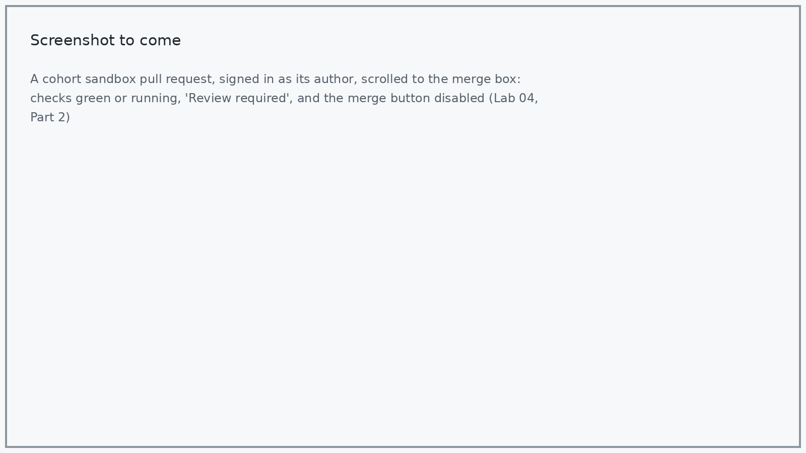
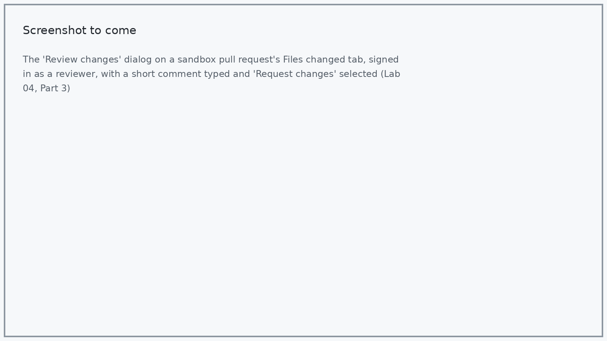

# Lab 04: A change through review

Your cohort shares one Tiny Tapeout repository, the sandbox. Each of its sixteen output pins is
driven by a slot, and each slot starts empty. You'll claim one pin for a small block, in a pull
request that a classmate has to approve before it can merge; you'll review a classmate's pull
request and ask for a change; and when someone claims the pin next to yours first, you'll resolve
the conflict that leaves in your branch.

Package: [`labs/lab-04-a-change-through-review/`](https://github.com/uoftasic/ic102-d/tree/main/labs/lab-04-a-change-through-review)

## Before you start

- Read [Pull requests and review](../guide/pull-requests-and-review.md),
  [Branch rules](../guide/branch-rules.md) and
  [How open-source projects work](../guide/how-open-source-projects-work.md).
- Accept your invitation to the `uoftasic` organization on GitHub. You'll get it by email, or
  from the banner at <https://github.com/uoftasic>. Membership is what lets you push branches to
  the sandbox; the token from Lab 01, Part 2 works for organization repositories as well as your
  own, because a classic token isn't tied to one account's repositories.
- Find a partner from your cohort. You'll review each other's pull requests, so agree on that
  before you start.
- Every command runs in a terminal on the workbench desktop. In each new terminal, run these
  first; the steps use `$L` for this lab's package and `$TT` for the test job's tools:

  ```bash
  . /foss/designs/common/.designinit
  L=/foss/designs/modules/ic102-d/labs/lab-04-a-change-through-review
  TT=/foss/designs/modules/ic102-d/labs/common/tt-tools
  ```

The steps use `uoftasic/ic102-d-sandbox` as the sandbox's name. Your cohort's may have a suffix;
the course tells you which one is yours.

This lab takes about an hour, plus 5 to 10 minutes on GitHub's runners each time you push.

## Part 1: The sandbox and its rules

What will GitHub let you do to the sandbox's `main`, and what did it let the team do without
rules?

1. Clone the sandbox and set your name, address and token cache for it, as in Lab 01:

   ```bash
   cd /foss/designs/modules
   git clone https://github.com/uoftasic/ic102-d-sandbox.git sandbox
   cd sandbox
   git config user.name "Your Name"
   git config user.email "ID+USERNAME@users.noreply.github.com"
   git config credential.helper 'cache --timeout=28800'
   ```

2. Read `README.md`, `CONTRIBUTING.md` and `RULESET.md`. `RULESET.md` describes the rules on
   `main` in the five parts [Branch rules](../guide/branch-rules.md#what-a-ruleset-is) uses, and
   the same ruleset is on GitHub at `https://github.com/uoftasic/ic102-d-sandbox/rules`.

3. Before you try it, write down what will happen if you commit straight to `main` and push.
   Then try it with a commit that changes nothing:

   ```bash
   git commit --allow-empty -m "Try to push to main"
   git push origin main
   ```

   <!-- RUN-TODO: the full output of `git push origin main` when the sandbox's ruleset refuses a direct push (the GH013 rule-violation lines). -->

   This is your first push to the sandbox, so git first asks for your username and token, as in
   Lab 01. Then GitHub rejects the commit, because the ruleset only lets changes reach `main`
   through a pull request, and the error names that rule. Throw the commit away:

   ```bash
   git reset --hard origin/main
   ```

4. Rules exist because a pull request without them merges whenever someone presses the button.
   `check-pr.py` in this lab's package reads a pull request from GitHub's public API; try it on
   `sentry`'s pull request #33, the one with thirteen reviews in
   [Pull requests and review](../guide/pull-requests-and-review.md#what-review-is-for):

   ```bash
   python3 $L/check-pr.py uoftasic/sentry 33 33
   ```

   You should see, with the two people's GitHub usernames where we've put roles:

   ```
   uoftasic/sentry #33: Event Decoder FSM
     author        <author>
     merged        2026-11-02T03:53:11Z
     approved by   <reviewer> at 2026-11-02T03:53:32Z after the merge
   ```

   then a second block, headed with #33 again, which says the author hasn't requested changes on
   it, then two `todo` lines and `VERDICT: not yet`. Those are about your own work: it's the check
   you'll run at the end of this lab, with this pull request standing in for both of yours. The approval came 21 seconds after the merge. `sentry` has no
   ruleset, so nothing made the merge wait for it. In the sandbox the merge button stays grey
   until the approval is there.

5. Run the sandbox's tests with the test job's tools:

   ```bash
   make -C "$TT" test PROJECT="$PWD"
   ```

   You should see one test per slot, sixteen in all, ending with
   `** TESTS=16 PASS=16 FAIL=0 SKIP=0`. An unclaimed slot's test checks that its pin stays 0;
   a claimed slot's test is whatever its claimant wrote.

You should see: a refused push, and sixteen passing tests on `main`.

## Part 2: Claim a pin

What does a pull request need for a classmate to review it in five minutes?

1. Pick a pin nobody has claimed: look at the table in `docs/info.md` on `main`, and at the open
   pull requests on GitHub, where everyone's claims in progress are. Then pick a block:

   ```bash
   python3 $L/claim.py --list
   ```

   You should see eight blocks, from `parity` ("1 when an odd number of the eight ui_in pins are
   1") to `toggle`. A `uio` pin works too; the block then makes the pin an output. If you'd rather
   write a block of your own, copy the shape of an unclaimed `src/slot_<pin>.v`.

2. Make a branch named after what it does, and put the block in your slot. With `parity` on
   `uo[3]` it looks like this:

   ```bash
   git switch -c claim-uo3-parity
   python3 $L/claim.py parity uo3 --by <your-github-username>
   ```

   You should see:

   ```
   Wrote src/slot_uo3.v and test/test_uo3.py (parity on uo[3]).
   Now edit by hand: the line `uo[3]: ""` in info.yaml, and the `uo[3]` row of the table in docs/info.md.
   ```

3. Make those two edits yourself. They're the claim that the datasheet and the next person
   read, and they're where conflicts happen. `git diff -- info.yaml docs/info.md` should show
   one changed line in each file, like this one from a practice run:

   ```
   -| `uo[3]` | unclaimed | |
   +| `uo[3]` | parity: 1 when an odd number of ui_in pins are 1 | student-a |
   ```

   ```
   -  uo[3]: ""
   +  uo[3]: "parity of ui_in"
   ```

4. Run the tests, and read your slot's test in `test/test_<pin>.py` while they run:

   ```bash
   make -C "$TT" test PROJECT="$PWD"
   ```

   You should see your slot's test pass, as `test_uo3.test_uo3_parity PASS 650.00` did, and
   sixteen tests in all.

5. Commit, push the branch, and open a pull request into `main`:

   ```bash
   git add -A
   git commit -m "Claim uo[3] for a parity block"
   git push -u origin claim-uo3-parity
   ```

   Open the link that `git push` prints. The description starts from the sandbox's template; fill
   in every section, including the test summary you just saw and whether an AI tool wrote any of
   it. Open it as a draft if you're still working, and mark it ready for review when you're done.
   Then request your partner as its reviewer.

6. The sandbox's workflows run on pull requests, so the checks start now. Before they finish,
   predict whether you could merge if they all passed.

   <details>
   <summary>Answer</summary>

   No. The ruleset needs one approval from someone other than you, as well as the five checks,
   and you can't approve your own pull request.

   </details>

   <!-- SCREENSHOT-TODO: a sandbox pull request, signed in as its author, scrolled to the merge box: checks green or running, "Review required", and the merge button disabled. -->
   {width=640}

You should see: your pull request open, with five checks running and a review requested.

## Part 3: Review a classmate's pull request

What can you find in your partner's change that no check can?

1. Open your partner's pull request. Read the description first, then **Files changed**, then the
   checks. Go through the list in `CONTRIBUTING.md`: the test, the pin, only four files changed,
   the description, the checks.

2. The starter tests from `claim.py` check two input values each. Find out whether that's enough
   for your partner's block: check out their branch, break their block in a way that still
   passes those two values, and run the tests. For a parity block, a version that looks at only
   half the inputs does it:

   ```bash
   git fetch origin
   git switch --detach origin/claim-uo3-parity
   sed -i 's/assign out = \^in;/assign out = ^in[3:0];/' src/slot_uo3.v
   make -C "$TT" test PROJECT="$PWD"
   ```

   You should see `test_uo3.test_uo3_parity PASS 650.00`, although the block now ignores
   `ui_in[7:4]`. Then put things back:

   ```bash
   git checkout -- .
   git switch -
   ```

   `git switch -` takes you back to the branch you were on before.

   (Use your partner's branch, slot and block in place of these. For another block, think about
   which inputs its two test values never exercise.)

3. Write your review. On **Files changed**, press **Review changes**, choose **Request changes**,
   and say what to add and why: which input values, and which wrong block they would catch.
   Add comments on any line where you found something else.

   <!-- SCREENSHOT-TODO: the "Review changes" dialog on a sandbox pull request's Files changed tab, signed in as a reviewer, with a short comment typed and "Request changes" selected. -->
   {width=640}

You should see: your review on your partner's pull request, marked "requested changes".

## Part 4: Merge, and resolve a conflict

What happens to an approval when you push again?

1. When your partner's review of your pull request arrives, make the change they asked for: add
   the test cases, run the tests, commit and push to the same branch. Reply to each comment and
   resolve it, because the ruleset won't merge with a conversation still open.

2. When your partner approves and the checks are green, merge your pull request. If GitHub says
   the branch has conflicts instead, someone has claimed a pin next to yours since you branched.
   Their line and yours are neighbours in both `info.yaml` and `docs/info.md`, and git won't
   merge two changes to adjacent lines by itself. Bring `main` into your branch:

   ```bash
   git fetch origin
   git merge origin/main
   ```

   <!-- SCREENSHOT-TODO: a sandbox pull request, signed in, with the merge box saying "This branch has conflicts that must be resolved" and naming info.yaml and docs/info.md. -->

   In a practice run, where `uo[3]` merged first and the branch claimed `uo[4]`, that printed:

   ```
   Auto-merging docs/info.md
   CONFLICT (content): Merge conflict in docs/info.md
   Auto-merging info.yaml
   CONFLICT (content): Merge conflict in info.yaml
   Automatic merge failed; fix conflicts and then commit the result.
   ```

   and `info.yaml` held:

   ```
   <<<<<<< HEAD
     uo[3]: ""
     uo[4]: "majority of ui_in[2:0]"
   =======
     uo[3]: "parity of ui_in"
     uo[4]: ""
   >>>>>>> origin/main
   ```

3. Resolve it: keep both claims (here, `uo[3]: "parity of ui_in"` and
   `uo[4]: "majority of ui_in[2:0]"`), delete the three marker lines, and do the same in
   `docs/info.md`. Then finish the merge, test, and push:

   ```bash
   git add info.yaml docs/info.md
   git commit --no-edit
   make -C "$TT" test PROJECT="$PWD"
   git push
   ```

   You should see both claimed slots' tests pass in the run, and the conflict message gone from
   the pull request.

4. Before you look, predict whether your pull request is still approved.

   <details>
   <summary>Answer</summary>

   No. The ruleset dismisses an approval when new commits arrive, because the reviewer approved
   the commits they saw, and the merge commit you just pushed isn't one of them. Ask your partner
   to look again and approve.

   </details>

5. Merge once the approval and the checks are back. Then run the check on your own work, with
   your pull request's number and the number of the one you reviewed:

   ```bash
   python3 $L/check-pr.py uoftasic/ic102-d-sandbox <your PR> <the PR you reviewed>
   ```

   <!-- RUN-TODO: check-pr.py's output for a merged sandbox pull request that was approved before the merge, and a reviewed one whose author pushed after a change request. -->

You should see: your pull request merged, and your pin's row filled in on `main`.

## Part 5: A pull request written by an AI tool (optional)

About 15 minutes. The course opens one pull request in each sandbox, "Claim uio[7]: heartbeat",
whose code and description an AI coding tool wrote. Its description says so in its last line,
and that the course left problems in it on purpose. All sixteen tests pass on it with the
course's tools; we checked, and that's part of the exercise.

Review it as you reviewed your partner's, but treat every statement in its description as a
claim to check, as [Pull requests and review](../guide/pull-requests-and-review.md#pull-requests-written-with-ai-tools)
suggests. Leave a review that requests changes and names each problem you find, with the file
and line. Don't approve it, and don't merge it, even if the rules would let you.

<details>
<summary>Answer</summary>

There are three. `src/slot_uio7.v` sets `oe` to 0, so `uio[7]` stays an input and the heartbeat
never leaves the chip, while `info.yaml` calls it an output. `test/test_uio7.py` has its only
real assertion commented out ("flaky at gate level", which nobody showed), its last assertion
(`in (0, 1)`) can't fail, and it never checks `uio_oe`. And the description says the tests pass
"with cocotb 2.0.1", which is the workbench's version; the runner and the course's `make test`
use 2.1.0.

</details>

## Finishing

You're done when `check-pr.py` prints `VERDICT: PASS` for your pull request and the one you
reviewed: yours merged after someone else approved it, and the review you wrote asked for a
change that its author then pushed.

Questions:

1. Your test passed before your partner asked for more cases, and it passes after. What did the
   new cases buy?

   <details>
   <summary>Answer</summary>

   A test that fails on blocks that are wrong in ways the old one missed, like the half-parity
   block in Part 3. A test is worth as much as the wrong designs it can catch, and you can only
   find that out by trying some, which is what you did as a reviewer.

   </details>

2. Two classmates claimed `uo[3]` and `uo[4]` and got a conflict. Would claims on `uo[3]` and
   `uo[5]` have conflicted?

   <details>
   <summary>Answer</summary>

   No. Git merges two changes cleanly when at least one unchanged line separates them, and the
   `uo[4]` line would sit between them. Neighbouring lines conflict because git can't tell
   whether the two edits depend on each other.

   </details>

Submit: the links to your pull request and to the review you wrote.

## Going further (optional)

The sandbox's workflows differ from the template's in their `on:` section and in one line of the
`viewer` job. Compare `.github/workflows/gds.yaml` in the sandbox with your own repository's, and
work out why a pull request in the sandbox runs each workflow once, where a branch push in your
own repository runs it on every push, and why `viewer` shows as skipped on pull requests.
[Reading a workflow file](../guide/reading-a-workflow-file.md#the-parts-of-a-workflow-file) has
the parts you need.

Next on the [Course path](../index.md#course-path): read
[History as evidence](../guide/history-as-evidence.md), then do
[Lab 05: Find the commit that broke it](lab-05-find-the-commit-that-broke-it-overview.md).
