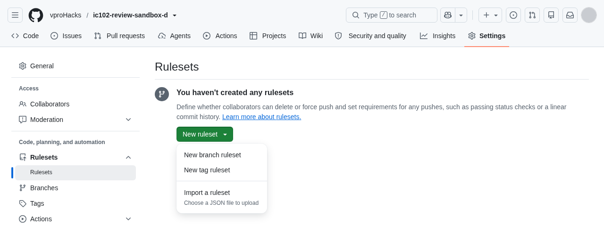
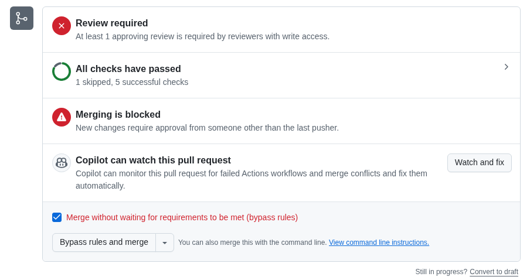
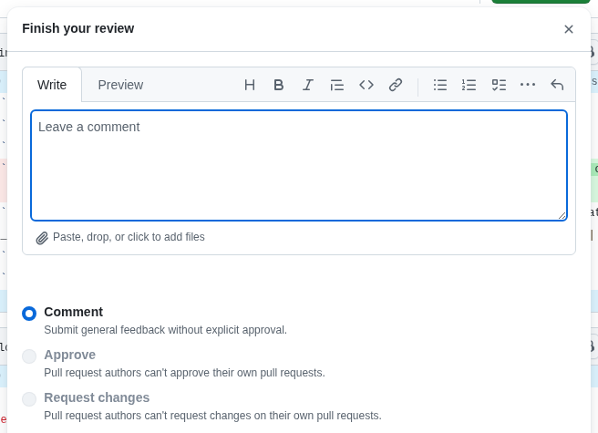
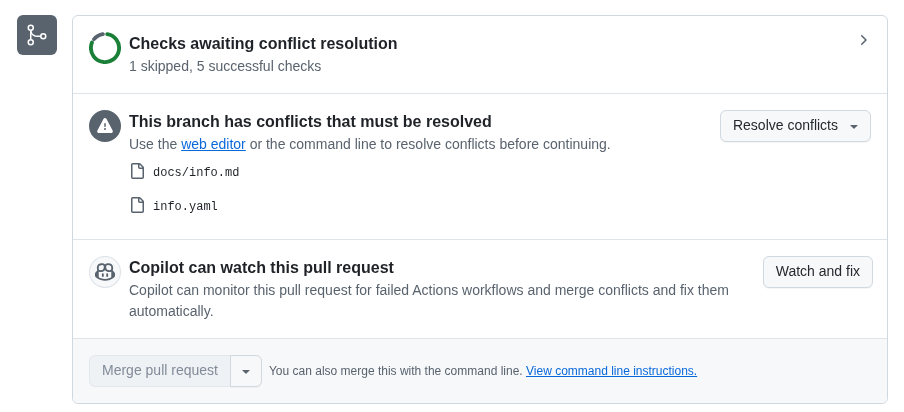

# Lab 04: A change through review

You and a partner each make a small Tiny Tapeout project of your own, the review sandbox, and put
branch rules on it. Each of its sixteen output pins is driven by a slot that starts empty. You'll
claim a pin in your partner's sandbox with a pull request from a fork, and your partner has to
approve it before it can merge. In your own sandbox you'll review your partner's pull request and
ask for a change. You'll also claim the pin next to theirs yourself, which leaves them a conflict
to resolve, and their claim in their own sandbox leaves you one.

Package: [`labs/lab-04-a-change-through-review/`](https://github.com/uoftasic/ic102-d/tree/main/labs/lab-04-a-change-through-review)

## Before you start

- Read [Pull requests and review](../guide/pull-requests-and-review.md),
  [Branch rules](../guide/branch-rules.md) and
  [How open-source projects work](../guide/how-open-source-projects-work.md).
- Find a partner who's doing this lab at the same time as you. You each own one repository and
  contribute to the other's, so you'll wait for each other a few times; agree how you'll say
  when you're ready (the team Discord is fine).
- You need the token from Lab 01, Part 2. Its Workflows permission matters here, because the
  first push of your sandbox includes the files in `.github/workflows/`.
- Every command runs in a terminal on the workbench desktop. In each new terminal, run these
  first; the steps use `$L` for this lab's package and `$TT` for the test job's tools:

  ```bash
  . /foss/designs/common/.designinit
  L=/foss/designs/modules/ic102-d/labs/lab-04-a-change-through-review
  TT=/foss/designs/modules/ic102-d/labs/common/tt-tools
  ```

The steps write `YOUR-USERNAME` and `PARTNER-USERNAME` for your two GitHub usernames, and `N` for
a pull request's number. The examples have you claim `uo[3]` for a parity block in your
partner's repository, and `uo[4]` for a majority block in your own; use your own pins and blocks.

This lab takes about 1 hour 45 minutes. That includes the 5 to 10 minutes GitHub's runners take
after each push, but not the time you spend waiting for your partner.

## Part 1: Your review repository

What does it take to turn the course's folder into a repository with rules on it?

1. On GitHub, create a new public repository called `ttsky-ic102-d-review` in your own account.
   Leave it empty: no README, no `.gitignore` and no licence, because the sandbox has its own.

   {width=640 fig-alt="GitHub's Create a new repository form. Under General, Owner is vproHacks and Repository name is ttsky-ic102-d-review, with the note ttsky-ic102-d-review is available. The Description box is empty. Under Configuration, Choose visibility is set to Public, Start with a template to No template, Add README is switched Off, Add .gitignore reads No .gitignore and Add license reads No license."}

2. Make a repository from the sandbox folder, and push it:

   ```bash
   mkdir -p /foss/designs/projects && cd /foss/designs/projects
   cp -r $L/sandbox ttsky-ic102-d-review
   cd ttsky-ic102-d-review
   git init -b main
   git config user.name "Your Name"
   git config user.email "ID+USERNAME@users.noreply.github.com"
   git config credential.helper 'cache --timeout=28800'
   git add -A
   git commit -m "Start from the IC102-D review sandbox"
   git remote add origin https://github.com/YOUR-USERNAME/ttsky-ic102-d-review.git
   git push -u origin main
   ```

   You should see `50 files changed, 1495 insertions(+)` from the commit, and the push end with
   `* [new branch]      main -> main` and `branch 'main' set up to track 'origin/main'.`

   <!-- RUN-TODO: GitHub's message when the token has no Workflows permission (the push of .github/workflows/ refused), to quote here. The live test on Nov 16, 2026 couldn't make a fine-grained token, so this is still open; the push itself, with gh's OAuth token (scope workflow), ended as quoted above. -->

3. The push starts the sandbox's three workflows, and `viewer` fails with the 404 from Lab 01,
   because Pages is off in a new repository. Turn Pages on as in
   [Lab 01, Part 5](lab-01-your-repo-from-the-template-overview.md#part-5-turn-on-pages), then
   start a new run of `gds` with **Run workflow** on `main`. (A re-run would fail, for the reason
   that part gives.)

4. Add the rules. On GitHub, open **Settings › Rules › Rulesets**, choose **New ruleset ›
   Import a ruleset**, and pick `ruleset.json` from your clone. On your laptop it's in the
   `projects/ttsky-ic102-d-review` folder of your workspace. Before you press **Create**, check
   the page against `RULESET.md`, which describes the same ruleset in the five parts of
   [Branch rules](../guide/branch-rules.md#what-a-ruleset-is). The bypass list has one entry, the
   repository's admin role (which is you), set to "For pull requests only".

   {width=640}

5. Before you try it, write down what will happen if you commit straight to `main` and push.
   Then try it with a commit that changes nothing, and throw the commit away afterwards:

   ```bash
   git commit --allow-empty -m "Try to push to main"
   git push origin main
   git reset --hard origin/main
   ```

   GitHub refuses the push and names the rules, although the repository is yours. In the course's
   practice sandbox the push printed:

   ```
   remote: error: GH013: Repository rule violations found for refs/heads/main.
   remote: Review all repository rules at https://github.com/vproHacks/ic102-review-sandbox-d/rules?ref=refs%2Fheads%2Fmain
   remote:
   remote: - Changes must be made through a pull request.
   remote:
   remote: - 5 of 5 required status checks are expected.
   remote:
   To https://github.com/vproHacks/ic102-review-sandbox-d.git
    ! [remote rejected] main -> main (push declined due to repository rule violations)
   error: failed to push some refs to 'https://github.com/vproHacks/ic102-review-sandbox-d.git'
   ```

   The bypass list lets you skip the approval, but only in a pull request.

You should see: all three workflows green on your `main`, `viewer` included, and a direct push
refused.

## Part 2: Claim a pin in your partner's repository

What does a pull request need for your partner to review it in five minutes?

1. Fork your partner's repository: open `https://github.com/PARTNER-USERNAME/ttsky-ic102-d-review`
   and press **Fork**, at the top right. On the page that opens, set **Owner** to your own
   account. **Repository name** starts out as the name of the repository you're forking, and you
   already have a `ttsky-ic102-d-review`, so change it to `ttsky-ic102-d-review-fork`. Then press
   **Create fork** ([forking a repository](https://docs.github.com/en/pull-requests/how-tos/work-with-forks/fork-a-repo)).
   The fork is yours to push to; your partner's `main` changes only through pull requests.

2. Clone your fork, and add your partner's repository as a second remote called `upstream`, so
   you can fetch what they merge:

   ```bash
   cd /foss/designs/projects
   git clone https://github.com/YOUR-USERNAME/ttsky-ic102-d-review-fork.git
   cd ttsky-ic102-d-review-fork
   git config user.name "Your Name"
   git config user.email "ID+USERNAME@users.noreply.github.com"
   git config credential.helper 'cache --timeout=28800'
   git remote add upstream https://github.com/PARTNER-USERNAME/ttsky-ic102-d-review.git
   git remote -v
   ```

   You should see `origin` (your fork) and `upstream` (your partner's), each twice.

3. Pick a block. `python3 $L/claim.py --list` prints eight, from `parity` ("1 when an odd number
   of the eight ui_in pins are 1") to `toggle`. Pick a pin from `uo[0]` to `uo[6]`: your partner
   will claim the one after yours, and the optional Part 6 uses `uio[7]`. Then make a branch named
   after what it does, and put the block in your slot:

   ```bash
   git switch -c claim-uo3-parity
   python3 $L/claim.py parity uo3 --by YOUR-USERNAME
   ```

   You should see:

   ```
   Wrote src/slot_uo3.v and test/test_uo3.py (parity on uo[3]).
   Now edit by hand: the line `uo[3]: ""` in info.yaml, and the `uo[3]` row of the table in docs/info.md.
   ```

4. Make those two edits yourself. They're the claim that the datasheet and the next person read,
   and they're where conflicts happen. `git diff -- info.yaml docs/info.md` should show one
   changed line in each file, like these from a practice run:

   ```
   -  uo[3]: ""
   +  uo[3]: "parity of ui_in"
   ```

   ```
   -| `uo[3]` | unclaimed | |
   +| `uo[3]` | parity: 1 when an odd number of ui_in pins are 1 | student-b |
   ```

5. Run the tests, and read your slot's test in `test/test_uo3.py` while they run:

   ```bash
   make -C "$TT" test PROJECT="$PWD"
   ```

   You should see `test_uo3.test_uo3_parity PASS 650.00`, and `** TESTS=16 PASS=16 FAIL=0
   SKIP=0`. An unclaimed slot's test checks that its pin stays 0.

6. Commit, push the branch to your fork, and open a pull request into your partner's `main`:

   ```bash
   git add -A
   git commit -m "Claim uo[3] for a parity block"
   git push -u origin claim-uo3-parity
   ```

   Open the link that `git push` prints, and check that the base repository is your partner's
   and the base branch is `main`. The description starts from the sandbox's template: fill in
   every section, including the test summary you just saw and whether an AI tool wrote any of it.
   Then tell your partner the pull request's number.

7. Before your partner does anything, predict whether this pull request could be merged once its
   checks pass.

   <details>
   <summary>Answer</summary>

   No. Your partner's ruleset needs an approval from someone with write access, which only your
   partner has, and only your partner can press the merge button in a repository you can't push
   to. The checks won't even start until your partner approves them. You've never had a commit
   or pull request merged into their repository, which makes you a first-time contributor there,
   and by default GitHub holds a first-time contributor's workflow runs until someone with write
   access approves them
   ([workflows from forks](https://docs.github.com/en/repositories/managing-your-repositorys-settings-and-features/enabling-features-for-your-repository/managing-github-actions-settings-for-a-repository#controlling-changes-from-forks-to-workflows-in-public-repositories)).

   </details>

You should see: your pull request open on your partner's repository, with its checks waiting
for your partner to approve them.

## Part 3: A neighbouring claim

What happens to an open pull request when `main` changes under it?

1. Open the pull request your partner made on your repository. Its workflows haven't run, because
   your partner has never had a commit or pull request merged into your repository, and by
   default GitHub holds a first-time contributor's runs until you approve them. Their pull
   request runs code they wrote on your repository's runners, and it can change the workflow
   files themselves, so GitHub wants you to look at it first. GitHub's documentation gives the
   steps
   ([approving workflow runs from forks](https://docs.github.com/en/actions/how-tos/manage-workflow-runs/approve-runs-from-forks)):
   on the pull request's **Files changed** tab, read the changes, paying most attention to
   anything in `.github/workflows/`. Then press **Awaiting approval**, at the top right, which
   opens the **Merge status** panel, and press **Approve workflows to run**.

   The same documentation says that runs may need approving when the person who opened the pull
   request, or the person whose action started the runs, is someone who needs approval, and
   that, with the default setting, anyone who has had a commit or pull request merged into the
   repository no longer needs it
   ([workflows from forks](https://docs.github.com/en/repositories/managing-your-repositorys-settings-and-features/enabling-features-for-your-repository/managing-github-actions-settings-for-a-repository#controlling-changes-from-forks-to-workflows-in-public-repositories)).
   So the runs of your partner's later pushes can be held too, until their first pull request is
   merged. Approve them the same way whenever GitHub asks.

2. Look at **Files changed** and note the pin your partner claimed. Claim the one after it
   yourself, in your own clone, on a branch, the same way as in Part 2 (the two edits by hand,
   then the tests):

   ```bash
   cd /foss/designs/projects/ttsky-ic102-d-review
   git switch -c claim-uo4-majority
   python3 $L/claim.py majority uo4 --by YOUR-USERNAME
   ```

   You should see `test_uo4.test_uo4_majority PASS 650.00` among sixteen passing tests. Commit,
   `git push -u origin claim-uo4-majority`, and open the pull request into your own `main`.

3. When its five checks are green, merge it. GitHub says "Review required" and "Merging is
   blocked", and offers you a box to tick, **Merge without waiting for requirements to be met
   (bypass rules)**, because the ruleset puts you on the bypass list "For pull requests only".
   Tick it and press **Bypass rules and merge**.

   {width=640}

   You can't approve your own pull request: GitHub greys out **Approve** and **Request changes**
   for its author. And your partner couldn't have approved it in a way that counts, because only
   approvals from people with write access count, and your partner has none.

   {width=520}

4. Predict what your partner's pull request says now, then look at it.

   <details>
   <summary>Answer</summary>

   "This branch has conflicts that must be resolved", in `info.yaml` and `docs/info.md`. Your
   line and theirs are neighbours in both files, and git won't merge two changes to adjacent
   lines by itself, because it can't tell whether one depends on the other. Above it, the checks
   now say "Checks awaiting conflict resolution".

   {width=640}

   </details>

You should see: your claim merged, `main`'s runs green, and a conflict on your partner's pull
request.

## Part 4: Review your partner's pull request

What can you find in your partner's change that no check can?

1. Read the description first, then **Files changed**, then the checks. Go through the list in
   `CONTRIBUTING.md`: the test, the pin, only four files changed, the description, the checks.

2. The starter tests from `claim.py` check two input values each. Find out whether that's enough
   for your partner's block: check out their branch, break their block in a way that still passes
   those two values, and run the tests. GitHub keeps every pull request's latest commit in the
   repository it's aimed at, as `refs/pull/N/head`, so you can fetch it without adding your
   partner's fork as a remote. For a parity block, a version that looks at only half the inputs
   does that:

   ```bash
   git switch main
   git pull
   git fetch origin pull/N/head
   git switch --detach FETCH_HEAD
   sed -i 's/assign out = \^in;/assign out = ^in[3:0];/' src/slot_uo3.v
   make -C "$TT" test PROJECT="$PWD"
   ```

   You should see `* branch            refs/pull/N/head -> FETCH_HEAD` from the fetch, and then
   `test_uo3.test_uo3_parity PASS 650.00`, although the block now ignores `ui_in[7:4]`. Put
   things back with `git checkout -- .` and `git switch main`.

   (Use your partner's slot and block in place of these. For another block, think about which
   inputs its two test values never exercise.)

3. Write your review. On **Files changed**, press **Submit review**, choose **Request changes**,
   and say what to add and why: which input values, and which wrong block they would catch. Add
   comments on any line where you found something else.

   <!-- SCREENSHOT-TODO: the "Finish your review" dialog (opened with "Submit review") on a pull request's Files changed tab in a student's ttsky-ic102-d-review, signed in as the owner reviewing a partner's pull request, with a short comment typed and "Request changes" selected. Needs two accounts: GitHub doesn't let a pull request's author request changes on it, so the one-account live test on Nov 16, 2026 could show only the author's side (the picture in Part 3). -->
   {width=640}

You should see: your review on your partner's pull request, marked "requested changes".

## Part 5: Answer the review and resolve the conflict

What happens to an approval when you push again?

1. When your partner's review of your pull request arrives, make the change they asked for in
   your fork's clone: add the test cases, run the tests, commit, and push to the same branch.
   Reply to each comment and resolve it, because the ruleset won't merge with a conversation still
   open. In the practice run, the parity test's list of cases became
   `[(0x00, 0), (0x01, 1), (0x10, 1), (0x80, 1), (0xF0, 0), (0xFF, 0)]`, and the test reported
   `PASS 1050.00`. Ask your partner to look again. Your pull request gets no new runs yet,
   because GitHub doesn't run `pull_request` workflows on a pull request that has a conflict. (In
   the practice sandbox, this push started no runs at all.)

2. When your partner approves, the pull request still can't merge, because of the conflict from
   Part 3. Bring your partner's `main` into your branch:

   ```bash
   git fetch upstream
   git merge upstream/main
   ```

   In the practice run, where `uo[4]` had been merged into `main` and the branch claimed `uo[3]`,
   that printed:

   ```
   Auto-merging docs/info.md
   CONFLICT (content): Merge conflict in docs/info.md
   Auto-merging info.yaml
   CONFLICT (content): Merge conflict in info.yaml
   Automatic merge failed; fix conflicts and then commit the result.
   ```

   and `info.yaml` held:

   ```
   <<<<<<< HEAD
     uo[3]: "parity of ui_in"
     uo[4]: ""
   =======
     uo[3]: ""
     uo[4]: "majority of ui_in[2:0]"
   >>>>>>> upstream/main
   ```

3. Resolve it: keep both claims (here, `uo[3]: "parity of ui_in"` and
   `uo[4]: "majority of ui_in[2:0]"`), delete the three marker lines, and do the same with the two
   rows in `docs/info.md`. Then finish the merge, test, and push:

   ```bash
   git add info.yaml docs/info.md
   git commit --no-edit
   make -C "$TT" test PROJECT="$PWD"
   git push
   ```

   You should see both claimed slots' tests pass, `test_uo3.test_uo3_parity PASS 1050.00` and
   `test_uo4.test_uo4_majority PASS 650.00`, with `TESTS=16 PASS=16`, and the conflict message
   gone from the pull request.

4. Before you look, predict whether your pull request is still approved.

   <details>
   <summary>Answer</summary>

   No. The ruleset dismisses an approval when new commits arrive, because the reviewer approved
   the commits they saw, and the merge commit you just pushed isn't one of them. It also requires
   the last push to be approved by someone other than the person who pushed it. Ask your partner
   to approve the runs and the pull request again.

   </details>

5. Your partner merges it, since only they can. Then run the check on your own work, with your
   pull request and the one you reviewed:

   ```bash
   python3 $L/check-pr.py PARTNER-USERNAME/ttsky-ic102-d-review#N YOUR-USERNAME/ttsky-ic102-d-review#N
   ```

   <!-- RUN-TODO: check-pr.py's output for a pull request from a fork that was merged after the owner approved it, and a reviewed one whose author pushed after a change request. Needs two accounts. In the one-account live test it read both real pull requests (vproHacks/ic102-review-sandbox-d#1 and #2) and printed "approved by   nobody yet", "vproHacks hasn't requested changes on it" and VERDICT: not yet, as it should. -->

You should see: your pull request merged, and both pins' rows filled in on your partner's
`main`.

## Part 6: A pull request written by an AI tool (optional)

About 15 minutes. The course has a pull request, "Claim uio[7]: heartbeat", whose code and
description an AI coding tool wrote. Its description says so in its last line, and says that the
course left problems in it on purpose. All sixteen tests pass on it with the course's tools (we
checked), and that's part of the exercise. You each open it on the other's repository, and each
review the one opened on your own.

1. In your fork's clone, put it on a branch of its own, push it, and open a pull request into
   your partner's `main` titled `Claim uio[7]: heartbeat`, with the text of
   `$L/ai-pr/pr-body.md` as its description:

   ```bash
   cd /foss/designs/projects/ttsky-ic102-d-review-fork
   python3 $L/ai-pr.py
   git push -u origin ai-claim-uio7-heartbeat
   ```

   You should see `Committed the AI-written pull request as ... on branch
   ai-claim-uio7-heartbeat.`

2. When your partner's arrives on your repository, approve its runs if GitHub asks, and review it
   as you reviewed their claim, but treat every statement in its description as a claim to check, as
   [Pull requests and review](../guide/pull-requests-and-review.md#pull-requests-written-with-ai-tools)
   suggests. Request changes, naming each problem you find with its file and line. Don't approve
   it and don't merge it; close it when you're done.

<details>
<summary>Answer</summary>

There are three problems. `src/slot_uio7.v` sets `oe` to 0, so `uio[7]` stays an input and the
heartbeat never leaves the chip, while `info.yaml` calls it an output. `test/test_uio7.py` has
its only real assertion commented out ("flaky at gate level", which the pull request gives no
evidence for), its last assertion (`in (0, 1)`) can't fail, and it never checks `uio_oe`. And
the description says the tests pass
"with cocotb 2.0.1", which is the workbench's version; the runner and the course's `make test`
use 2.1.0.

</details>

## Finishing

You're done when `check-pr.py` prints `VERDICT: PASS` for your pull request and the one you
reviewed: yours was merged into your partner's repository after they approved it, and the review
you wrote in yours asked for a change that its author then pushed.

Questions:

1. Your test passed before your partner asked for more cases, and it passes after. What did the
   new cases buy?

   <details>
   <summary>Answer</summary>

   They gave you a test that fails on blocks that are wrong in ways the old one missed, such as
   the half-parity block in Part 4. What a test is worth depends on which wrong designs it can
   catch, and the only way to find out is to try some, as you did when you reviewed your
   partner's pull request.

   </details>

2. You and your partner claimed `uo[3]` and `uo[4]` and got a conflict. Would claims on `uo[3]`
   and `uo[5]` have conflicted?

   <details>
   <summary>Answer</summary>

   No. Git merges two changes cleanly when at least one unchanged line separates them, and the
   `uo[4]` line would sit between them. Neighbouring lines conflict because git can't tell
   whether the two edits depend on each other.

   </details>

Submit: the links to your pull request and to the review you wrote.

## Going further (optional)

Rules exist because without them a pull request merges whenever someone presses the button. Try
`check-pr.py` on `sentry`'s pull request #33, the one with thirteen reviews in
[Pull requests and review](../guide/pull-requests-and-review.md#what-review-is-for), giving it as
both of the pull requests it asks for:

```bash
python3 $L/check-pr.py uoftasic/sentry#33 uoftasic/sentry#33
```

Its first block reads as follows, with roles in place of the two people's usernames:

```
uoftasic/sentry #33: Event Decoder FSM
  author        <author>
  merged        2026-11-02T03:53:11Z
  approved by   <reviewer> at 2026-11-02T03:53:32Z after the merge
```

The approval came 21 seconds after the merge, because `sentry` has no ruleset and nothing made
the merge wait for it.

The sandbox's workflows differ from the template's in their `on:` section and in one line of the
`viewer` job. Compare `.github/workflows/gds.yaml` in the sandbox with your own `ttsky-ic102-d`'s,
and work out why your partner's pull request from a fork got runs at all, why each workflow ran
once per push to it, and why `viewer` shows as skipped on pull requests.
[Reading a workflow file](../guide/reading-a-workflow-file.md#the-parts-of-a-workflow-file) has
the parts you need.

Next on the [Course path](../index.md#course-path): read
[History as evidence](../guide/history-as-evidence.md), then do
[Lab 05: Find the commit that broke it](lab-05-find-the-commit-that-broke-it-overview.md).
