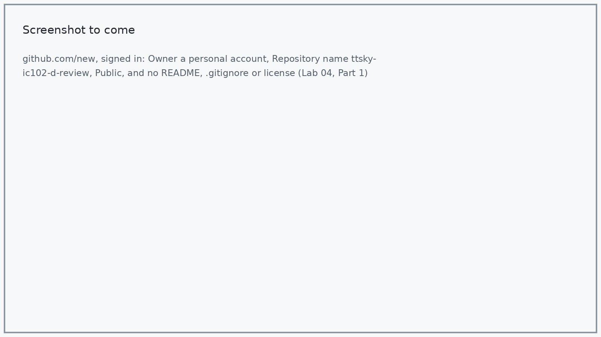

# Lab 05: Find the commit that broke it

You'll take over the history of a small Tiny Tapeout project, an LED dimmer that three teammates
wrote over five weeks. Its test passed at the commit they tagged `v1.0`, and it fails now, 27
commits later. You'll write a script that `git bisect run` can trust, use it to find the commit
that broke the test, revert that commit on a branch, and get the revert through every workflow
in a pull request on a repository of your own.

Package: [`labs/lab-05-find-the-commit-that-broke-it/`](https://github.com/uoftasic/ic102-d/tree/main/labs/lab-05-find-the-commit-that-broke-it)

## Before you start

- Read [History as evidence](../guide/history-as-evidence.md).
- Finish [Lab 03](lab-03-make-it-yours-overview.md). This lab uses the test job's tools you
  installed in [Lab 01, Part 1](lab-01-your-repo-from-the-template-overview.md#part-1-load-the-course),
  your access token from Lab 01, Part 2, and the way you turned on Pages in Lab 01, Part 5.
- Every command runs in a terminal on the workbench desktop, where `git bisect run` can call the
  same `make test` as Lab 03. In each new terminal, run these first; the steps use `$TT` for the
  test job's tools:

  ```bash
  . /foss/designs/common/.designinit
  TT=/foss/designs/modules/ic102-d/labs/common/tt-tools
  ```

The teammates are made up, and so is their project, which the course builds from Tiny Tapeout's
template with a script. Every commit is an ordinary one, though: features, tests, documentation,
two half-finished edits, a new file left out of the test's source list, and one tidy-up that
went wrong.

This lab takes about 45 minutes, plus the 5 to 10 minutes each push takes on GitHub's runners.

## Part 1: The history you're given

What does the test say now, and what did it say at `v1.0`?

1. Clone the history. The course ships it as a git bundle, a single file that holds every
   commit and tag, and `git clone` reads it like a repository:

   ```bash
   cd /foss/designs/modules
   git clone ic102-d/labs/lab-05-find-the-commit-that-broke-it/data/history.bundle dimmer
   cd dimmer
   git config user.name "Your Name"
   git config user.email "ID+USERNAME@users.noreply.github.com"
   ```

   Use the same no-reply address as in Lab 01. You should see `Cloning into 'dimmer'...`.

2. Look at the history:

   ```bash
   git log --oneline | wc -l
   git log --oneline v1.0..main | wc -l
   git log --oneline -3
   ```

   You should see `36`, then `27`, then:

   ```
   d79cae5 test: name the LED's pin in failure messages
   5e4eac6 info.yaml: a longer description
   881ab8e test: run fade mode for 100 steps
   ```

   Every hash in this lab is exact, because the course built each commit with a fixed author,
   date and message.

3. Run the test on `main`, as the test job would:

   ```bash
   make -C "$TT" test PROJECT="$PWD"
   ```

   You should see three of seven tests fail:

   ```
   AssertionError: with duty 0 the LED (uo_out[7]) was on for 8 of 2048 cycles, expected 0
   AssertionError: with duty 64 the LED (uo_out[7]) was on for 260 of 1024 cycles, expected 256
   AssertionError: with duty 255 the LED (uo_out[7]) was on for 1024 of 1024 cycles, expected 1020
   ```

   and `** TESTS=7 PASS=4 FAIL=3 SKIP=0` in the summary table, followed by
   `make: *** [Makefile:42: test] Error 2`.

4. Before you run it, write down whether the test passes at `v1.0`. Then check:

   ```bash
   git switch --detach v1.0
   make -C "$TT" test PROJECT="$PWD"
   git switch main
   ```

   You should see `** TESTS=3 PASS=3 FAIL=0 SKIP=0`. The test had only three cases then, all of
   them about the PWM, and all three pass.

5. Somewhere in the 27 commits between `v1.0` and `main`, the PWM broke. How many tests will
   `git bisect` need to find the commit?

   <details>
   <summary>Answer</summary>

   About five. Each test halves the number of suspects, and $2^5 = 32 \ge 27$. One commit that
   can't be tested may add a test or two, as you'll see in Part 2.

   </details>

You should see: three PWM failures on `main`, and a pass at `v1.0`.

## Part 2: A script `git bisect run` can trust

What should the script say about a commit whose design doesn't compile?

1. Copy the starting script to the top of your clone, and read it:

   ```bash
   cp ../ic102-d/labs/lab-05-find-the-commit-that-broke-it/bisect-template.sh bisect.sh
   ```

   It runs the test job's steps with `run-test.sh`, the script behind Lab 03's `make test`, and
   then always exits 0. The comment at the top lists the three answers `git bisect run`
   understands: 0 for good, 1 to 127 except 125 for bad, and 125 for "can't test this one".
   `bisect.sh` isn't tracked by git, so checking out old commits leaves it alone.

2. Why can't the script simply exit with `run-test.sh`'s status? Try it on `main`, where a test
   fails, and on `18bb2c3`, a commit from the middle of the history:

   ```bash
   for c in main 18bb2c3; do
     git checkout -q $c; rm -f test/results.xml
     "$TT/run-test.sh" . > /dev/null 2>&1
     echo "$c: exit $?; $(ls test/results.xml 2>&1)"
   done
   git checkout -q main
   ```

   You should see:

   ```
   main: exit 2; test/results.xml
   18bb2c3: exit 2; ls: cannot access 'test/results.xml': No such file or directory
   ```

   Both exit with 2. With cocotb 2.x, `make` runs cocotb's own results check at the end of the
   simulation, so it stops with `Error 2` when a test fails, and it stops with the same status
   when the design doesn't compile. The difference shows in `test/results.xml`: cocotb writes it
   whenever the simulation runs, and never when the compile fails. (This is also why the script
   deletes `results.xml` before each run. An old one, left from the previous commit, would answer
   for a commit that never ran.)

3. Replace the last line of `bisect.sh` (`exit 0`, under the TODO) with the rule the
   [History as evidence](../guide/history-as-evidence.md#finding-the-commit-that-broke-it) script
   uses for `protocol-emulator`, where a missing `results.xml` counts as bad:

   ```bash
   if [ ! -f test/results.xml ]; then
       exit 1
   fi
   if grep -q "<failure" test/results.xml; then
       exit 1
   fi
   exit 0
   ```

4. Run the bisect between the last known good commit and `main`:

   ```bash
   git bisect start main v1.0
   git bisect run ./bisect.sh
   ```

   It takes about ten seconds. You should see it test five commits and end with:

   ```
   fc5cc5a476c68cbb622e46b8add1001daba389ab is the first bad commit
   commit fc5cc5a476c68cbb622e46b8add1001daba389ab
   Author: Sam Rivera <sam.rivera@example.com>
   Date:   Thu Oct 15 20:25:00 2026 -0400

       Move the seven-segment table into seg7_table.v

    info.yaml        |  1 +
    src/seg7.v       | 24 +++---------------------
    src/seg7_table.v | 35 +++++++++++++++++++++++++++++++++++
    3 files changed, 39 insertions(+), 21 deletions(-)
    create mode 100644 src/seg7_table.v
   bisect found first bad commit
   ```

5. Is `fc5cc5a` the commit that broke the PWM? The script kept a log of each commit it tested;
   read this one, and the next commit's message:

   ```bash
   grep error /tmp/bisect-fc5cc5a.log
   git log --oneline -1 d139224
   ```

   <details>
   <summary>Answer</summary>

   No. The log has a line ending in `src/seg7.v:15: error: Unknown module type: seg7_table`: the
   commit added a
   new file to `info.yaml` but not to `PROJECT_SOURCES` in `test/Makefile`, so the design didn't
   compile and the test never ran. The very next commit, `d139224 test/Makefile: add
   seg7_table.v to PROJECT_SOURCES`, fixed that, and nothing about the PWM changed. The script
   called a commit bad that couldn't be tested at all, and `git bisect` believed it.

   The same rule was right for `protocol-emulator`, because there the failure being hunted *was*
   a compile error (a module the testbench could no longer find). Here the failure being hunted
   is a wrong value from the PWM, and a commit that doesn't compile tells you nothing about it.

   </details>

6. End this bisect, change the first `exit 1` in `bisect.sh` (the one under
   `if [ ! -f test/results.xml ]`) to `exit 125`, and run it again:

   ```bash
   git bisect reset
   git bisect start main v1.0
   git bisect run ./bisect.sh
   git bisect log
   ```

   You should see the first commit it checks out, `18bb2c3 WIP: preset brightness levels on
   uio_in[2:1]`, reported as skipped in the log, six commits tested in all, and a different first
   bad commit. Write down its hash and message before you open the answer.

   <details>
   <summary>Answer: the bisect, from <code>git bisect log</code></summary>

   ```
   # bad: [d79cae577f82c23a00bd6b0e0ded14e2978ec07f] test: name the LED's pin in failure messages
   # good: [d4d038ba667d42a39ddb955b82267b263b25aa56] docs: say how the dimmer works
   git bisect start 'main' 'v1.0'
   # skip: [18bb2c3886dabbc0d52c37b69df06162904c424b] WIP: preset brightness levels on uio_in[2:1]
   git bisect skip 18bb2c3886dabbc0d52c37b69df06162904c424b
   # good: [93f6c9b3054e94dc368f29375b4132a15b567d2a] prescaler: make the divide ratio a parameter
   git bisect good 93f6c9b3054e94dc368f29375b4132a15b567d2a
   # good: [8fe18a97d47bc988f0c411d085ec373aaf9a21fd] info.yaml: describe uio[1] and uio[2]
   git bisect good 8fe18a97d47bc988f0c411d085ec373aaf9a21fd
   # bad: [529a940503d3d8a5cbd9fdc2429e2347480836af] test: check that every uio pin is an input
   git bisect bad 529a940503d3d8a5cbd9fdc2429e2347480836af
   # bad: [65dcd89cd6b967a95b608cf3265ca8d11d8093e2] pwm: tidy up the comparator and its comments
   git bisect bad 65dcd89cd6b967a95b608cf3265ca8d11d8093e2
   # good: [f79e8d0b394eaede2f0ff239f58ffb0100f5f173] test: run the testbench clock at 10 MHz, to match clock_hz
   git bisect good f79e8d0b394eaede2f0ff239f58ffb0100f5f173
   # first bad commit: [65dcd89cd6b967a95b608cf3265ca8d11d8093e2] pwm: tidy up the comparator and its comments
   ```

   </details>

7. Read the commit, then end the bisect:

   ```bash
   git show <the first bad commit>
   git bisect reset
   ```

   Its message says it tidied up the comparator and its comments. Which line changed what the
   circuit does, and why does that turn the LED on for exactly 8 of 2048 cycles at duty 0?

   <details>
   <summary>Answer</summary>

   `assign out = (phase < duty);` became `assign out = (phase <= duty);`. The phase counts 0 to
   255, once per PWM period, so with duty 0 the new comparison is true for one step in every
   period, when the phase is 0. A step lasts four clock cycles (the prescaler divides by 4), and
   the test watches two periods: $2 \times 4 = 8$ cycles. The same extra step gives 260 instead
   of 256 cycles at duty 64, and turns duty 255 into always on. The four changed comment lines
   around it make the diff look like a comment edit, which is how it got past its author.

   </details>

8. Check your script against three commits whose answers are known:

   ```bash
   python3 ../ic102-d/labs/lab-05-find-the-commit-that-broke-it/check.py --offline
   ```

   You should see, after about a minute:

   ```
   Your bisect.sh, run at three commits (about a minute)
     d4d038b  v1.0, test passes            exit 0    ok
     18bb2c3  preset WIP, doesn't compile  exit 125  ok
     d79cae5  last commit, test fails      exit 1    ok
   ```

   followed by `no commit made by git revert on this branch yet`, which Part 3 fixes.

You should see: `git bisect` name a commit whose diff changes the PWM, and three `ok` lines from
the check.

## Part 3: The revert

Can you undo that one commit without undoing the seven commits that came after it?

1. Before you run anything, look at what the seven later commits touched
   (`git log --stat --oneline <the first bad commit>..main`). Write down whether you expect
   `git revert` to apply cleanly.

   <details>
   <summary>Answer</summary>

   It should. None of the later commits touch `src/pwm.v`, so the lines the revert puts back
   haven't moved, and git can apply the reverse of the old diff directly.

   </details>

2. Make a branch for the fix and revert the commit on it:

   ```bash
   git switch -c revert-pwm-compare main
   git revert --no-edit <the first bad commit>
   git log -1 --format=%B
   ```

   You should see `1 file changed, 4 insertions(+), 4 deletions(-)` and a message that ends with
   `This reverts commit <its full hash>.` The new commit's own hash will differ from anyone
   else's, because it carries your name and the time.

3. Run the test again:

   ```bash
   make -C "$TT" test PROJECT="$PWD"
   ```

   You should see all seven pass, among them `test.test_duty_0_is_off PASS 205250.00` and
   `** TESTS=7 PASS=7 FAIL=0 SKIP=0`. The fade, preset and display tests added after the bad
   commit still pass, because the revert undid only the comparator.

4. Commit your script on the branch, so that the pull request carries the evidence:

   ```bash
   git add bisect.sh
   git commit -m "Add the bisect script that found the PWM regression"
   ```

You should see: seven passing tests on your branch, with the later features still in place.

## Part 4: The pull request

Does GitHub's runner agree with your workbench?

1. On GitHub, create a new public repository called `dimmer` in your own account. Leave it
   empty: no README, no `.gitignore`, no licence, because the history you push already has its
   own first commit.

   <!-- SCREENSHOT-TODO: github.com/new, signed in: Owner set to a personal account, Repository name "dimmer", Public selected, and "Add a README file", ".gitignore" and "license" all left at None/unticked. -->
   {width=640}

2. Point your clone at it and push `main` and the tag. The push sends files under
   `.github/workflows/`, which GitHub accepts only from a token with the `workflow` scope, the
   one you ticked in Lab 01, Part 2:

   ```bash
   git remote set-url origin https://github.com/<your-username>/dimmer.git
   git config credential.helper 'cache --timeout=28800'
   git push -u origin main --tags
   ```

3. Before you look at the Actions tab, predict the result of each job on `main`: `docs`, `test`,
   `gds`, `precheck`, `gl_test` and `viewer`.

   <details>
   <summary>Answer</summary>

   `docs`, `gds` and `precheck` should pass, because the files they check are fine. `test` fails
   on the three PWM cases, and so does `gl_test`, which runs the same test on the gate-level
   netlist. `viewer` fails with the 404 from Lab 01, because a new repository has Pages off.

   </details>

   <!-- RUN-TODO: the six job results of the first push of the Lab 05 history (main at d79cae5) to a new public repository, and the first error line of test, gl_test and viewer. -->

4. Turn Pages on for `dimmer` the way you did in Lab 01, Part 5.

5. Push your branch and open a pull request from `revert-pwm-compare` into `main`:

   ```bash
   git push -u origin revert-pwm-compare
   ```

   GitHub prints a link for creating the pull request. In the description, name the commit you
   reverted and why it was wrong, say how you found it, and paste the output of `git bisect log`
   from Part 2. If an AI tool helped you write the script or the description, say so and say what
   you checked yourself, as [Pull requests and review](../guide/pull-requests-and-review.md#pull-requests-written-with-ai-tools)
   asks.

6. Wait for the runs on your branch to finish (about 5 to 10 minutes), then run the full check:

   ```bash
   python3 ../ic102-d/labs/lab-05-find-the-commit-that-broke-it/check.py
   ```

   It repeats Part 2's three runs and then reads your branch's latest commit from GitHub.

   <!-- RUN-TODO: check.py's full output on a revert-pwm-compare branch whose six jobs have all passed on GitHub. -->

You should see: all six jobs green on the pull request, and `VERDICT: PASS`.

## Finishing

You're done when `check.py`, run on your `revert-pwm-compare` branch, prints `VERDICT: PASS`:
your script gives the right answer at all three commits, your branch reverts the commit that
broke the test, and all six jobs passed on the branch's latest commit.

Questions:

1. Your script and the `protocol-emulator` script in History as evidence give opposite answers
   for a commit that doesn't compile. Can both be right?

   <details>
   <summary>Answer</summary>

   Yes, because they hunt different failures. In `protocol-emulator` the test broke *because*
   the testbench stopped compiling, so a commit that doesn't compile shows the bug. In the dimmer
   the bug is a wrong value from a design that compiles, so a commit that doesn't compile can't
   show it either way, and 125 tells git to look at a neighbour instead. Decide what you're
   hunting before you decide what the script says.

   </details>

2. The `v1.0` tag saved you a step. What would you have had to do without it?

   <details>
   <summary>Answer</summary>

   Find a good commit yourself before `git bisect start` could begin, by checking out older
   commits and running the test until one passed. A tag on a commit that everyone saw green is a
   known-good starting point for anyone who comes later, which is why
   [History as evidence](../guide/history-as-evidence.md#marking-a-commit) suggests marking one.

   </details>

3. The bad commit was made on Oct 25, and seven more commits followed before anyone noticed. In
   the team's real repositories the test workflow runs on every push. What does that suggest the
   made-up team was doing wrong?

   <details>
   <summary>Answer</summary>

   They weren't looking at their runs. On GitHub, the `test` workflow would have gone red on the
   push that included `65dcd89`, and every push after it. A red cross that stays red for a week
   is one nobody is reading, which is how `hart-1`'s `docs` and `gds` stayed red for four weeks.

   </details>

Submit: the link to your pull request.

## Going further (optional)

When you already know which line is wrong, git can find the commit that touched it without
running anything. `git log -G` lists the commits whose diffs add or remove a line matching a
pattern:

```bash
git log --oneline -G "phase <" -- src/pwm.v
```

```
65dcd89 pwm: tidy up the comparator and its comments
aff17a4 Add an 8-bit PWM
```

That's the commit that wrote the comparison and the commit that changed it. `git bisect` is for
the more common case, where you know only that the test fails.

This is the last row of the [Course path](../index.md#course-path).
