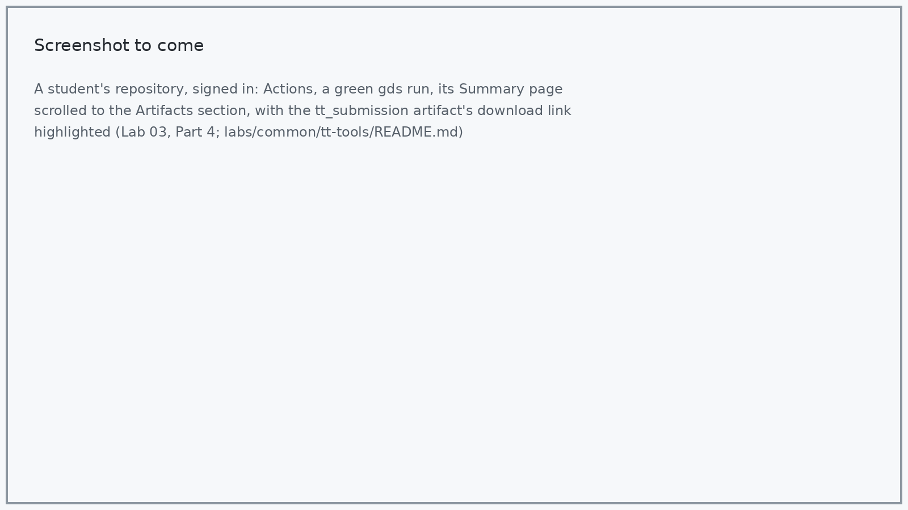

# `labs/common/tt-tools`: the runner's test tools in the workbench

When you push to a repository made from Tiny Tapeout's Verilog template, the `test` workflow runs your cocotb test on a GitHub runner with Python 3.11, cocotb 2.1.0, pytest 8.4.2 and Icarus Verilog 12.0, which it installs from Ubuntu's packages. The `gl_test` job in the `gds` workflow runs the same test again on the gate-level netlist, with Tiny Tapeout's own build of Icarus 13.0. The workbench image has cocotb 2.0.1 and Icarus 14.0, so a test that passes in the workbench has not yet passed with the runner's tools. This folder installs the runner's versions next to the workbench's, without changing the image, and runs your test the way each job does. IC102-D pins these versions on purpose; the other courses keep the workbench's.

The writeups that use it are [Lab 03](https://uoftasic.com/ic102-d/labs/lab-03-make-it-yours-overview.html) and [Lab 05](https://uoftasic.com/ic102-d/labs/lab-05-find-the-commit-that-broke-it-overview.html), and [Your tools and the runner's tools](https://uoftasic.com/ic102-d/guide/your-tools-and-the-runners-tools.html) explains why the versions differ.

## Install

Everything here runs in a terminal on the workbench desktop. If you haven't set up the workbench, do [IC101 Lab 03](https://uoftasic.com/ic101/labs/lab-03-launch-the-workbench-overview.html) first.

```bash
. /foss/designs/common/.designinit
mod add ic102-d                  # first time only
mod ic102-d
cd labs/common/tt-tools
make install
```

`make install` took 4.7 s on one CPU core with a fast connection and leaves 178 MB in `.local/`: Python 3.11 (90 MB), a venv with cocotb and pytest (23 MB), Icarus 12.0 (6.7 MB) and Icarus 13.0 (58 MB). `.local/` is on your own disk (the workspace folder is mounted at `/foss/designs`), so it survives a container restart and you install once. If a download fails partway, run `make install` again: it skips the parts that finished.

Then check what you got:

```bash
make check-tools
```

You should see:

```
Tool (job)             Runner         Here           Workbench      Status
----------             ------         ----           ---------      ------
Python (test)          3.11.18        3.11.16        3.12.3         ok (3.11)
cocotb (test)          2.1.0          2.1.0          2.0.1          ok
pytest (test)          8.4.2          8.4.2          9.1.1          ok
Icarus (test)          12.0           12.0           14.0           ok
Icarus (gl_test)       13.0           13.0           14.0           ok
sky130A (gl_test)      8afc8346a57f   -              026824c7969c   not installed (optional)
LibreLane (gds)        3.0.14         -              3.1.0.dev3     not installed: the gds job runs on GitHub

All pinned tools are installed at the runner's versions.
```

The "Runner" column is what the template's jobs used when we read their logs on Nov 15 and 16, 2026, "Here" is what `make install` put in `.local/`, and "Workbench" is what the image has. Python matches on 3.11 rather than on the last digit, because the `uv` in the image offers nothing newer than 3.11.16; the cocotb package is built for 3.11 either way. (cocotb's startup log says `Using Python 3.11.14 interpreter` both here and on the runner, although the runner runs 3.11.18 and this venv 3.11.16, so that line reports the Python cocotb's package was built with, not the one running it.)

To see the whole chain work, run the template's own test, from the template commit the course was written against:

```bash
make selftest
```

It takes about 3 s and ends with:

```
** TEST                          STATUS  SIM TIME (ns)  REAL TIME (s)  RATIO (ns/s) **
**************************************************************************************
** test.test_project              PASS      100000.00           0.00   69443719.17  **
**************************************************************************************
** TESTS=1 PASS=1 FAIL=0 SKIP=0             100000.00           0.00   58756615.67  **
```

The log above it says `Running on Icarus Verilog version 12.0 (stable)` and `Initialized cocotb v2.1.0`, which are the two lines the runner's log has for the same test. The `SIM TIME` column is exact, so yours should be 100000.00; the `REAL TIME` and `RATIO` columns measure your computer, so they will differ.

## Running your test

Point `PROJECT` at the top folder of your repository, the one with `info.yaml` in it:

```bash
make test PROJECT=/foss/designs/projects/ttsky-ic102-d
```

This runs the four lines of the workflow's "Run tests" step in your `test/` folder, `make clean`, `make`, and `python -m cocotb_tools.check_results results.xml`, with the runner's Python, cocotb and Icarus 12.0 first on the `PATH`. `check_results` reads `results.xml` and exits 1 if any test failed. The workflow's comment says the line is there because "make will return success even if the tests fail", which was true of cocotb 1.x. With cocotb 2.1.0, `make` runs `check_results` itself as the last line of its recipe for `results.xml` (in cocotb's `Makefile.icarus`), so a failing test makes `make` stop with `Error 2`, and the separate line is a second check that runs only when `make` passed. `make test` exits with whichever failed first. Two variants use the other Icarus versions:

```bash
make test-icarus13 PROJECT=/foss/designs/projects/ttsky-ic102-d     # gl_test's Icarus 13.0
make test-workbench PROJECT=/foss/designs/projects/ttsky-ic102-d    # the workbench's Icarus 14.0
```

## Icarus 12.0, 13.0 and 14.0

On the tests we ran, the three versions agreed whenever all three accepted the code: the template's test and the test of the team's Sentry project (at 544696e) passed with the same simulated times under 12.0, 13.0 and 14.0, both at RTL and on Sentry's gate-level netlist. They differ in what they accept: Icarus 12.0 rejects some SystemVerilog that 13.0 and 14.0 compile, so code you write and test in the workbench can stop the runner's `test` job at the compile step.

We changed the template's adder to compute the same sum in a `for` loop that ends with `break`, which is legal SystemVerilog, and ran `make test` three ways. With Icarus 12.0 the compile stopped at `project.v:27: sorry: break statements not supported.` and `make` ended with `make: *** [Makefile:42: test] Error 2`. With 13.0 and with 14.0 it printed `project.v:27: internal error: NetProc::nex_input not implemented`, carried on, and the test passed. Assigning a whole array at once (`q = '{8'd1, 8'd2, 8'd3, 8'd4};`) fails the same way on 12.0 only, with `sorry: Assignment to an entire array or to an array slice is not yet supported.` So test with `make test` before you push, and keep the workbench's Icarus for poking around.

## Your own requirements.txt

Both jobs run `pip install -r test/requirements.txt` from your repository, so the cocotb and pytest the runner uses are whatever that file says. The template pins cocotb 2.1.0 and pytest 8.4.2, which is what the venv here has. If your project changes the file, `make test` warns you before it runs. This is what it printed for Sentry, which pins cocotb 2.0.1:

```
warning: the runner installs your test/requirements.txt, and it differs from this venv:
  cocotb: your test/requirements.txt pins 2.0.1, this venv has 2.1.0
  Results here may not match the runner's. See README.md, 'Your own requirements.txt'.
```

The test still runs, with the venv's versions. To match the runner exactly in that case, put your project's versions in `requirements.txt` here and run `make install` again, which rebuilds the venv because the file changed. That edit leaves the course clone with a local change, so put the file back with `git checkout requirements.txt` when you're done, or a later `git pull` of the course may stop on it.

## The gate-level test (optional)

The `gl_test` job simulates the netlist that the `gds` job built, with the sky130 standard-cell models at the PDK commit LibreLane used (`8afc8346`, which is not the commit precheck or the workbench uses). To run it here you need those models and the netlist:

```bash
make install-gl
```

That took 7 s and adds 420 MB: the `sky130_fd_sc_hd` library at `8afc8346` (383 MB), which is the only part of the PDK `gl_test` reads, and the PDK installer `ciel` (37 MB). Then download the `tt_submission` artifact from your gds run's summary page on GitHub (you have to be signed in to see it), unzip it into your workspace, and point `SUBMISSION` at the `tt_submission` folder inside it:



```bash
make gl-test PROJECT=/foss/designs/projects/ttsky-ic102-d SUBMISSION=/foss/designs/tt_submission-unzipped/tt_submission
```

This copies the netlist to `test/gate_level_netlist.v` and runs `GATES=yes make` with Icarus 13.0, as `gl_test` does. On Sentry's netlist from run 43796948508 it printed `Running on Icarus Verilog version 13.0 (stable)` and `test.test_project PASS 100000.00`, the same result as the runner's gl_test job. If the artifact's `pdk.json` names a different PDK commit from the one installed, the script says so.

## Differences from the runner

| Difference | Why it doesn't change the result |
|---|---|
| Python 3.11.16 here, 3.11.18 on the runner | `setup-python` asks only for '3.11', so the runner itself takes whichever 3.11 it has that day. The packages are identical. |
| Icarus is unpacked from the same two `.deb` files the runner installs, behind wrappers that point it at its own helper folder | Same binaries; the wrappers add `-B` and `-M` paths and nothing else. |
| The gl-test PDK has only `sky130_fd_sc_hd` | `gl_test` reads two files from that library and nothing else in the PDK. |
| The `gds` job isn't reproduced | It runs LibreLane 3.0.14 inside LibreLane's own Docker image (Yosys 0.62, Magic 8.3.623, Netgen 1.5.316, Verilator 5.044 in the logs), and Docker doesn't run inside the workbench. The workbench's own LibreLane 3.1.0.dev3 can harden your design, but with different tool versions, so its results won't match the runner's exactly. |
| The `docs` job and `tt-support-tools` aren't installed | They check `info.yaml` and `docs/info.md`, not your design, and the docs job's log names the field or section that's wrong. |
| The runner's machine is Ubuntu 24.04.5, the workbench 24.04.4 | Nothing here depends on the point release. |

## Troubleshooting

| If you see | Do this |
|---|---|
| `warning: the runner installs your test/requirements.txt, and it differs from this venv` | See "Your own requirements.txt" above. |
| `sorry: ... not supported` from Icarus with `make test`, and no error with `make test-workbench` | Icarus 12.0 doesn't support that construct, so the runner's `test` job will fail the same way. Rewrite it in a form 12.0 accepts. |
| `make: *** [Makefile:42: test] Error 2` | `make` stopped because the step above it failed: a compile error, or `check_results` reporting a failed test. Read the lines above it. |

## Targets

| Target | What it does | Time (one core) |
|---|---|---|
| `make install` | Python 3.11 with cocotb and pytest, Icarus 12.0 and 13.0, into `.local/` | 4.7 s |
| `make install-gl` | The `sky130_fd_sc_hd` models for `make gl-test` | 7 s |
| `make check-tools` | Print each version next to the pin and the workbench's | instant |
| `make selftest` | The template's own test, as the test job runs it | 3 s |
| `make test PROJECT=<dir>` | Your test with the test job's tools | your test's time |
| `make test-icarus13 PROJECT=<dir>` | The same with gl_test's Icarus 13.0 | |
| `make test-workbench PROJECT=<dir>` | The same with the workbench's Icarus 14.0 | |
| `make gl-test PROJECT=<dir> SUBMISSION=<dir>` | The gate-level test, as gl_test runs it | |
| `make uninstall` | Delete `.local/` | |

## Files

| File | What it is |
|---|---|
| `pins.env` | Every pinned version, with the run or file it was read from. The other scripts read it, so a version changes in one place. |
| `requirements.txt` | The test job's Python packages, copied from its pip log, with every dependency pinned |
| `requirements-ciel.txt` | `ciel`, the PDK installer, for `make install-gl` |
| `install.sh` | The installer; `./install.sh icarus-12` redoes one part |
| `check-tools.sh` | `make check-tools` |
| `run-test.sh` | `make test`; `ICARUS=13` or `ICARUS=workbench` selects another Icarus |
| `run-gl-test.sh` | `make gl-test` |
| `check-requirements.sh` | The requirements warning, run by both of the above |
| `selftest.sh` | `make selftest`; `./selftest.sh all` runs it with all three Icarus versions |

When Tiny Tapeout moves the `ttsky26d` tag, or the template moves to a new tag, the versions in `pins.env` have to be read again from the new action files and a new runner log. The steps are at the top of `pins.env`.
